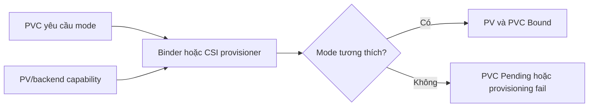

# Access Modes và Volume Modes

## Mục lục

- [Tổng quan](#tổng-quan)
- [1. Hai câu hỏi khác nhau khi yêu cầu storage](#1-hai-câu-hỏi-khác-nhau-khi-yêu-cầu-storage)
- [2. Access mode nằm ở đâu trong luồng PVC và PV](#2-access-mode-nằm-ở-đâu-trong-luồng-pvc-và-pv)
- [3. Bốn Access Modes](#3-bốn-access-modes)
- [4. RWO không có nghĩa là chỉ một Pod](#4-rwo-không-có-nghĩa-là-chỉ-một-pod)
- [5. Khi nào dùng RWOP](#5-khi-nào-dùng-rwop)
- [6. Hiểu đúng ROX và RWX](#6-hiểu-đúng-rox-và-rwx)
- [7. Volume Mode: Filesystem hay Block](#7-volume-mode-filesystem-hay-block)
- [8. Access Mode và Volume Mode kết hợp như thế nào](#8-access-mode-và-volume-mode-kết-hợp-như-thế-nào)
- [9. Binding matrix cho Volume Mode](#9-binding-matrix-cho-volume-mode)
- [10. Cách chọn mode theo requirement](#10-cách-chọn-mode-theo-requirement)
- [11. Thực hành với Filesystem Volume](#11-thực-hành-với-filesystem-volume)
- [12. Quan sát raw Block Volume an toàn](#12-quan-sát-raw-block-volume-an-toàn)
- [13. Scheduling, attach và concurrent access](#13-scheduling-attach-và-concurrent-access)
- [14. Troubleshooting theo triệu chứng](#14-troubleshooting-theo-triệu-chứng)
- [15. Checklist lựa chọn mode](#15-checklist-lựa-chọn-mode)
- [Tài liệu tham khảo](#tài-liệu-tham-khảo)

---

## Tổng quan

Khi tạo PersistentVolumeClaim (PVC), bạn thường gặp hai field có tên gần giống nhau:

```yaml
spec:
  accessModes:
    - ReadWriteOnce
  volumeMode: Filesystem
```

Hai field này trả lời **hai câu hỏi hoàn toàn khác nhau**:

1. **Access Mode:** Volume cần được truy cập từ bao nhiêu Node/Pod và theo hướng read-only hay read-write?
2. **Volume Mode:** Container nhìn thấy một thư mục filesystem hay một raw block device?

Có thể hình dung:

```text
Access Mode = ai/ở đâu được dùng volume?
              RWO / ROX / RWX / RWOP

Volume Mode = volume xuất hiện dưới dạng nào trong container?
              Filesystem / Block
```

Ví dụ:

- `ReadWriteOnce + Filesystem`: một disk được mount read-write trên một Node và container nhìn thấy thư mục như `/data`.
- `ReadWriteMany + Filesystem`: nhiều Node có thể mount shared filesystem read-write.
- `ReadWriteOncePod + Filesystem`: một Pod được dùng volume; container vẫn nhìn thấy thư mục.
- `ReadWriteOnce + Block`: một Node nhận raw block device; container nhìn thấy thiết bị như `/dev/xvda`.

> **Định nghĩa ngắn:** Access Mode mô tả **mô hình truy cập**, còn Volume Mode mô tả **cách volume được trình bày cho application**.

Nếu chỉ nhớ sáu điều, hãy nhớ:

1. Access Mode và Volume Mode là hai trục độc lập.
2. `ReadWriteOnce` (RWO) nghĩa là một **Node**, không phải một Pod.
3. `ReadWriteOncePod` (RWOP) mới là lựa chọn Kubernetes dành cho một Pod duy nhất, khi CSI driver hỗ trợ.
4. `ReadWriteMany` (RWX) không làm application tự an toàn với concurrent write.
5. `Filesystem` là default và phù hợp với phần lớn application.
6. `Block` đưa raw device vào container; application phải tự hiểu và quản lý device đó.

## 1. Hai câu hỏi khác nhau khi yêu cầu storage

Giả sử application cần 20Gi. Chỉ biết dung lượng chưa đủ. Kubernetes còn phải biết cách chọn và đưa volume vào Pod.

### Câu hỏi 1: Ai có thể truy cập?

Một số backend chỉ attach disk read-write vào một Node. Một số filesystem cho nhiều Node cùng mount. Một số workload cần bảo đảm chỉ một Pod dùng volume.

Đây là phạm vi của `accessModes`:

```yaml
accessModes:
  - ReadWriteOnce
```

### Câu hỏi 2: Application nhìn thấy gì?

Phần lớn application muốn một thư mục với file và directory. Một số storage engine chuyên dụng muốn thao tác trực tiếp trên block device.

Đây là phạm vi của `volumeMode`:

```yaml
volumeMode: Filesystem
```

Hai lựa chọn không tự chuyển đổi capability của backend:

- Chọn RWX không biến một cloud block disk chỉ attach một Node thành shared filesystem.
- Chọn `Block` không làm NFS share trở thành block device.
- Chọn `Block` không tự làm application nhanh hơn.
- Chọn RWO không tạo singleton lock cho một Pod.

CSI driver và storage backend phải hỗ trợ tổ hợp mà PVC yêu cầu.

## 2. Access mode nằm ở đâu trong luồng PVC và PV

Cả PVC và PersistentVolume (PV) đều có thông tin về mode, nhưng vai trò khác nhau:

| Object | Mode có ý nghĩa gì? |
|---|---|
| PVC | Workload **yêu cầu** access mode và volume mode |
| PV | Volume cụ thể **cung cấp** access mode và có volume mode cụ thể |
| Storage backend/CSI driver | Thực sự hỗ trợ attach, mount và I/O theo capability nào |
| Pod | Dùng PVC qua `volumeMounts` hoặc `volumeDevices` |

Với static provisioning, binder so sánh PVC và PV:

```text
PVC yêu cầu: RWO + Filesystem + 20Gi
                     │
                     ▼
PV cung cấp: RWO + Filesystem + 50Gi
                     │
                     ▼
                   Bind
```

Nếu mode không tương thích, PVC tiếp tục `Pending` dù class và dung lượng có vẻ đúng.

Với dynamic provisioning, provisioner nhận yêu cầu từ PVC và tạo volume/PV có capability phù hợp, nếu driver/backend hỗ trợ.



### Một volume chỉ bind với một PVC

RWX không có nghĩa một PV bind với nhiều PVC. Binding vẫn là một-một:

```text
một PV ↔ một PVC → nhiều Pod trong cùng Namespace có thể dùng PVC đó
```

Nếu nhiều Namespace cần cùng dataset, không thể tham chiếu trực tiếp cùng một PVC xuyên Namespace. Cần thiết kế export/service, copy/sync dữ liệu hoặc cơ chế platform phù hợp.

## 3. Bốn Access Modes

| Tên đầy đủ | Viết tắt | Contract chính |
|---|---|---|
| `ReadWriteOnce` | RWO | Volume có thể được mount read-write bởi một Node |
| `ReadOnlyMany` | ROX | Volume có thể được mount read-only bởi nhiều Node |
| `ReadWriteMany` | RWX | Volume có thể được mount read-write bởi nhiều Node |
| `ReadWriteOncePod` | RWOP | Volume có thể được mount read-write bởi một Pod trên toàn cluster |

Một PV có thể quảng bá nhiều access mode mà backend hỗ trợ, nhưng một volume chỉ được mount theo một access mode tại một thời điểm.

### Hình dung theo Node và Pod

```text
RWO
Node A: Pod 1 ─┐
        Pod 2 ─┴─ volume read-write
Node B: không đồng thời mount read-write volume đó

ROX
Node A: Pod 1 ─── volume read-only
Node B: Pod 2 ─── volume read-only

RWX
Node A: Pod 1 ─── volume read-write
Node B: Pod 2 ─── volume read-write

RWOP
Node A hoặc B: chỉ một Pod được dùng volume
```

Backend/CSI driver quyết định mode nào khả dụng. Ví dụ phổ biến:

- Cloud block storage thường cung cấp RWO; capability cụ thể phụ thuộc driver và sản phẩm.
- Shared filesystem như NFS hoặc distributed filesystem thường có thể cung cấp RWX/ROX.
- RWOP chỉ áp dụng cho CSI volume và cần driver/sidecar tương thích.

Không suy luận capability chỉ từ loại sản phẩm. Kiểm tra đúng CSI driver, version, StorageClass và storage tier đang dùng.

### Access Mode không phải quyền filesystem

Access Mode tham gia vào binding, scheduling và mount contract. Nó không thay thế:

- `volumeMounts[].readOnly`.
- Unix permission và UID/GID.
- NFS export option hoặc backend ACL.
- SELinux/AppArmor.
- File locking hoặc database fencing.

Ngay cả ROX cũng không nên được xem là security boundary duy nhất. Nếu container không cần ghi, khai báo mount read-only và cấu hình backend/export tương ứng.

## 4. RWO không có nghĩa là chỉ một Pod

`ReadWriteOnce` nói về **một Node**. Nhiều Pod trên cùng Node vẫn có thể cùng mount và ghi volume RWO:

```text
Node worker-a
├── Pod database-old ─┐
└── Pod database-new ─┴─ PVC RWO
```

Vì vậy, RWO không phải singleton lock. Những tình huống có thể tạo nhiều Pod gồm:

- Deployment có nhiều replica cùng tham chiếu một PVC.
- Pod cũ chưa dừng nhưng Pod mới đã được tạo trong rollout.
- Controller/failure handling tạo replacement trong khi trạng thái cũ chưa rõ.
- Hai workload khác nhau trong cùng Namespace cùng tham chiếu claim.

Nếu các Pod rơi vào hai Node khác nhau, bạn thường thấy `Multi-Attach error` hoặc scheduling bị chặn. Nếu chúng cùng ở một Node, mount có thể thành công và application mới là nơi chịu rủi ro concurrent write.

### Khi RWO vẫn phù hợp

RWO phù hợp khi:

- Backend là single-node attach block storage.
- Workload/controller bảo đảm concurrency theo cơ chế riêng.
- Mỗi StatefulSet replica có PVC riêng.
- Application có leader election, file lock hoặc fencing phù hợp.

Đừng dùng RWO như bằng chứng rằng chỉ một process có thể mở data directory.

## 5. Khi nào dùng RWOP

`ReadWriteOncePod` được thiết kế cho trường hợp volume chỉ được một Pod dùng trên toàn cluster:

```yaml
spec:
  accessModes:
    - ReadWriteOncePod
```

RWOP phù hợp hơn RWO khi requirement là “chỉ một Pod được mount volume”, ví dụ một workload single-writer không được phép có Pod cũ và Pod mới cùng truy cập PVC.

Điều kiện:

- Volume phải là CSI volume.
- CSI driver và các sidecar liên quan phải hỗ trợ RWOP.
- PV và PVC phải dùng mode tương thích.
- Cần test scheduling/failover thực tế; API chấp nhận manifest chưa đủ chứng minh backend hoạt động đúng.

RWOP vẫn không thay thế mọi lớp fencing:

- Storage có thể bị truy cập ngoài Kubernetes.
- Administrator có thể tạo mapping sai hoặc thao tác trực tiếp trên backend.
- Force detach khi Node cũ còn ghi vẫn có thể gây split-brain.
- RWOP không cung cấp transaction, replication hay database HA.

Dùng RWOP như một guardrail ở Kubernetes, đồng thời giữ cơ chế consistency/fencing phù hợp với application.

## 6. Hiểu đúng ROX và RWX

### ReadOnlyMany

ROX cho phép nhiều Node mount volume theo contract read-only. Use case thường gặp:

- Dataset dùng chung.
- Model artifact.
- Nội dung được publish một lần rồi nhiều workload đọc.

Tuy nhiên, cần xác minh:

- Container mount có `readOnly: true`.
- Backend export/ACL thực sự chặn write.
- Cache consistency khi source được cập nhật.
- Cách phát hành version mới của dataset.

Nếu dữ liệu immutable và cần phân phối rộng, container image, object storage hoặc CDN đôi khi phù hợp hơn shared filesystem.

### ReadWriteMany

RWX cho phép nhiều Node mount read-write. Use case thường gặp:

- Shared uploads/content.
- File exchange giữa nhiều worker.
- Legacy application yêu cầu shared filesystem.
- Build workspace mà tool đã có cơ chế phối hợp.

RWX **không** bảo đảm application an toàn với nhiều writer. Storage backend có thể cung cấp filesystem-level operations nhưng application vẫn phải hiểu:

- File locking.
- Atomic rename.
- `fsync` và durability semantics.
- Client cache/coherency.
- UID/GID và ownership.
- Latency khi nhiều client cùng ghi.
- Behavior khi network partition.

> [!WARNING]
> Không cho nhiều database instance cùng mở một data directory chỉ vì PVC là RWX, trừ khi chính database đó tài liệu hóa và hỗ trợ mô hình shared-disk tương ứng.

### Mount read-only ở cấp container

Một PVC RWX vẫn có thể được mount read-only trong một container:

```yaml
volumeMounts:
  - name: shared-data
    mountPath: /data
    readOnly: true
```

Cách này giảm quyền ghi của mount đó, nhưng backend ACL và security context vẫn phải được cấu hình đúng.

## 7. Volume Mode: Filesystem hay Block

Volume Mode quyết định thứ container nhìn thấy.

### Filesystem

`Filesystem` là default nếu bỏ `volumeMode`:

```yaml
spec:
  volumeMode: Filesystem
```

Pod dùng `volumeMounts`:

```yaml
volumeMounts:
  - name: data
    mountPath: /var/lib/app
```

Nếu backing volume là block device chưa có filesystem và driver hỗ trợ, Kubernetes/driver có thể tạo filesystem trước lần mount đầu. Sau đó container dùng file API bình thường.

Filesystem phù hợp với phần lớn application vì:

- Application làm việc với file và directory quen thuộc.
- Kubelet/CSI driver quản lý mount lifecycle.
- Dễ kiểm tra bằng `df`, `mount`, `stat` và filesystem tooling.
- Permission có thể quản lý bằng UID/GID, mode và `fsGroup` khi volume hỗ trợ.

Các vấn đề cần vận hành gồm inode, mount options, filesystem corruption, ownership và filesystem overhead.

### Block

`Block` giữ volume ở dạng raw block device:

```yaml
spec:
  volumeMode: Block
```

Pod dùng `volumeDevices`, không dùng `volumeMounts`:

```yaml
volumeDevices:
  - name: data
    devicePath: /dev/xvda
```

Container nhìn thấy device `/dev/xvda`; không có thư mục filesystem được mount từ volume đó. Application chịu trách nhiệm về data layout và I/O trực tiếp.

Raw block chỉ phù hợp khi application hoặc storage engine tài liệu hóa support rõ ràng. Application/operator phải hiểu:

- Block alignment và I/O size.
- Metadata/data layout.
- Flush/durability.
- Fencing và concurrent access.
- Recovery sau crash.
- Backup/snapshot semantics.

> [!CAUTION]
> Không chạy `mkfs`, `dd`, `wipefs` hoặc tool ghi lên raw device chỉ để kiểm tra. Những lệnh này có thể phá hủy dữ liệu ngay lập tức.

### Block không mặc định nhanh hơn

Bỏ filesystem layer có thể thay đổi overhead, nhưng hiệu năng thực tế còn phụ thuộc storage engine, I/O pattern, queue depth, driver và backend. Nếu application vốn dùng file API, đổi sang raw block đòi hỏi thay đổi kiến trúc chứ không phải chỉ sửa một field YAML.

## 8. Access Mode và Volume Mode kết hợp như thế nào

Hai trục có thể kết hợp nếu backend/driver hỗ trợ:

| Access Mode | Volume Mode | Container nhìn thấy | Ví dụ phù hợp |
|---|---|---|---|
| RWO | Filesystem | Một thư mục trên một Node | Phần lớn database replica dùng disk riêng |
| RWOP | Filesystem | Một thư mục dành cho một Pod | Single-writer workload cần guardrail chặt hơn |
| RWX | Filesystem | Shared filesystem trên nhiều Node | Shared uploads/content |
| ROX | Filesystem | Shared filesystem read-only | Dataset hoặc artifact dùng chung |
| RWO | Block | Raw device trên một Node | Storage engine quản lý block trực tiếp |
| RWOP | Block | Raw device dành cho một Pod | Single-writer raw block engine |

Không phải mọi tổ hợp đều tồn tại trên mọi StorageClass. Trước khi chọn, kiểm tra ba lớp:

1. CSI driver có hỗ trợ capability đó không?
2. Storage backend/tier có hỗ trợ không?
3. Application có sử dụng an toàn không?

Ví dụ, một StorageClass tên `fast` chưa nói nó hỗ trợ RWX hay raw block. Tên class là contract do platform định nghĩa; phải đọc tài liệu class/driver.

## 9. Binding matrix cho Volume Mode

Với PV tĩnh, `volumeMode` của PV và PVC phải tương thích. `Filesystem` là default khi field bị bỏ trống.

| PV `volumeMode` | PVC `volumeMode` | Có thể bind? | Lý do |
|---|---|---:|---|
| Bỏ trống | Bỏ trống | Có | Cả hai được hiểu là `Filesystem` |
| Bỏ trống | `Filesystem` | Có | PV mặc định là `Filesystem` |
| Bỏ trống | `Block` | Không | Filesystem và Block không tương thích |
| `Filesystem` | Bỏ trống | Có | PVC mặc định là `Filesystem` |
| `Filesystem` | `Filesystem` | Có | Mode khớp |
| `Filesystem` | `Block` | Không | Mode khác nhau |
| `Block` | Bỏ trống | Không | PVC mặc định yêu cầu `Filesystem` |
| `Block` | `Filesystem` | Không | Mode khác nhau |
| `Block` | `Block` | Có | Mode khớp |

Nếu PVC `Pending` dù PV đủ size, hãy kiểm tra `volumeMode` cùng với StorageClass và access modes.

### Access Modes khi binding

PVC có thể yêu cầu một hoặc nhiều access mode. PV phải quảng bá các mode đáp ứng request. Tuy nhiên, việc một PV liệt kê capability không tự chứng minh backend/export đã được cấu hình đúng. Static PV cần được administrator kiểm chứng end-to-end.

## 10. Cách chọn mode theo requirement

Bắt đầu từ requirement, không bắt đầu từ mode nghe “mạnh hơn”.

### Bước 1: Application cần file hay raw device?

- Nếu application đọc/ghi file hoặc directory: chọn `Filesystem`.
- Chỉ chọn `Block` khi application có raw block support rõ ràng.

### Bước 2: Có bao nhiêu writer?

- Một Pod duy nhất: ưu tiên RWOP nếu driver hỗ trợ và guardrail này cần thiết.
- Một Node nhưng application tự quản lý nhiều process/Pod: RWO có thể phù hợp.
- Nhiều Node cùng ghi: cần RWX và application-safe concurrency.
- Nhiều Node chỉ đọc: cân nhắc ROX hoặc cách phân phối immutable data khác.

### Bước 3: Backend có capability gì?

Kiểm tra:

- Tài liệu CSI driver và version.
- Tài liệu StorageClass do platform công bố.
- Access/volume mode của PV được tạo thật.
- Kết quả canary trên nhiều Node.

### Bước 4: Failure behavior là gì?

Trả lời trước khi production:

- Node cũ mất kết nối thì volume được fence/detach ra sao?
- Có thể xảy ra stale attachment không?
- Network partition ảnh hưởng RWX thế nào?
- Application xử lý hai writer hoặc read-only remount ra sao?
- Backup/restore có giữ đúng volume mode không?

Bảng định hướng:

| Requirement | Lựa chọn ban đầu | Cần xác minh |
|---|---|---|
| Một database replica, disk riêng | RWOP hoặc RWO + Filesystem | Driver support, fencing, reattach |
| StatefulSet, mỗi replica một disk | RWO/RWOP + Filesystem qua claim template | Zone, retention, backup |
| Nhiều web replica đọc dataset | ROX + Filesystem hoặc object/image distribution | Update/cache semantics |
| Nhiều replica ghi file chung | RWX + Filesystem | Locking, latency, permission |
| Storage engine quản lý device | RWO/RWOP + Block | Raw block support, recovery, alignment |

## 11. Thực hành với Filesystem Volume

Bài thực hành tạo PVC `RWO + Filesystem`, mount vào `/data` và ghi một file.

Prerequisite: chọn StorageClass hỗ trợ dynamic provisioning. Thay `REPLACE_WITH_STORAGE_CLASS` bằng tên thật:

```bash
kubectl get storageclass
```

Tạo file `filesystem-mode-demo.yaml`:

```yaml
apiVersion: v1
kind: Namespace
metadata:
  name: storage-mode-lab
---
apiVersion: v1
kind: PersistentVolumeClaim
metadata:
  name: filesystem-data
  namespace: storage-mode-lab
spec:
  storageClassName: REPLACE_WITH_STORAGE_CLASS
  accessModes:
    - ReadWriteOnce
  volumeMode: Filesystem
  resources:
    requests:
      storage: 1Gi
---
apiVersion: v1
kind: Pod
metadata:
  name: filesystem-consumer
  namespace: storage-mode-lab
spec:
  securityContext:
    fsGroup: 2000
  containers:
    - name: app
      image: busybox:1.36
      command: ["sh", "-c", "echo filesystem-ok > /data/message; sleep 3600"]
      volumeMounts:
        - name: data
          mountPath: /data
  volumes:
    - name: data
      persistentVolumeClaim:
        claimName: filesystem-data
```

Apply và quan sát:

```bash
kubectl apply -f filesystem-mode-demo.yaml
kubectl get pod,pvc -n storage-mode-lab -w
```

Khi Pod `Ready`, xác minh:

```bash
kubectl exec filesystem-consumer -n storage-mode-lab -- cat /data/message
kubectl exec filesystem-consumer -n storage-mode-lab -- df -h /data
kubectl exec filesystem-consumer -n storage-mode-lab -- mount
```

Expected result:

- PVC là `Bound`.
- Pod là `Running`/`Ready`.
- `/data/message` chứa `filesystem-ok`.
- `df` hiển thị filesystem chứa `/data`.

Trace mode từ PVC sang PV:

```bash
PV=$(kubectl get pvc filesystem-data -n storage-mode-lab -o jsonpath='{.spec.volumeName}')
kubectl get pvc filesystem-data -n storage-mode-lab \
  -o custom-columns=NAME:.metadata.name,ACCESS:.spec.accessModes,MODE:.spec.volumeMode,PV:.spec.volumeName
kubectl get pv "$PV" \
  -o custom-columns=NAME:.metadata.name,ACCESS:.spec.accessModes,MODE:.spec.volumeMode,DRIVER:.spec.csi.driver
```

Cả PVC và PV phải thể hiện mode tương thích.

### Cleanup

Trước khi xóa, kiểm tra reclaim policy:

```bash
kubectl get pv "$PV" \
  -o custom-columns=NAME:.metadata.name,RECLAIM:.spec.persistentVolumeReclaimPolicy,HANDLE:.spec.csi.volumeHandle
```

Sau khi xác nhận dữ liệu lab không cần giữ:

```bash
kubectl delete namespace storage-mode-lab
```

Nếu policy là `Retain`, PV/backend asset có thể còn lại và cần dọn theo runbook platform.

## 12. Quan sát raw Block Volume an toàn

Chỉ thực hiện phần này khi StorageClass và CSI driver xác nhận hỗ trợ raw block. Thay placeholder bằng class phù hợp.

Tạo file `block-mode-demo.yaml`:

```yaml
apiVersion: v1
kind: Namespace
metadata:
  name: block-mode-lab
---
apiVersion: v1
kind: PersistentVolumeClaim
metadata:
  name: block-data
  namespace: block-mode-lab
spec:
  storageClassName: REPLACE_WITH_BLOCK_STORAGE_CLASS
  accessModes:
    - ReadWriteOnce
  volumeMode: Block
  resources:
    requests:
      storage: 1Gi
---
apiVersion: v1
kind: Pod
metadata:
  name: block-consumer
  namespace: block-mode-lab
spec:
  containers:
    - name: inspector
      image: busybox:1.36
      command: ["sh", "-c", "ls -l /dev/xvda; sleep 3600"]
      volumeDevices:
        - name: data
          devicePath: /dev/xvda
  volumes:
    - name: data
      persistentVolumeClaim:
        claimName: block-data
```

Điểm khác với Filesystem manifest:

- PVC dùng `volumeMode: Block`.
- Container dùng `volumeDevices`.
- `devicePath` là `/dev/xvda`, không có `mountPath`.

Apply và chỉ kiểm tra device tồn tại:

```bash
kubectl apply -f block-mode-demo.yaml
kubectl get pod,pvc -n block-mode-lab -w
kubectl exec block-consumer -n block-mode-lab -- ls -l /dev/xvda
```

Không chạy command ghi dữ liệu trong bài quan sát này. Trước cleanup, lấy PV và đọc reclaim policy:

```bash
PV=$(kubectl get pvc block-data -n block-mode-lab -o jsonpath='{.spec.volumeName}')
kubectl get pv "$PV" \
  -o custom-columns=NAME:.metadata.name,MODE:.spec.volumeMode,RECLAIM:.spec.persistentVolumeReclaimPolicy,HANDLE:.spec.csi.volumeHandle
```

Cleanup sau khi xác nhận asset chỉ dùng cho lab:

```bash
kubectl delete namespace block-mode-lab
```

## 13. Scheduling, attach và concurrent access

Mode ảnh hưởng nhiều giai đoạn khác nhau:

```text
PVC/PV binding
      ↓
Scheduler chọn Node phù hợp topology
      ↓
Controller/CSI attach volume nếu cần
      ↓
Kubelet/CSI node plugin mount hoặc map device
      ↓
Application thực hiện I/O
```

| Giai đoạn | Mode ảnh hưởng thế nào | Lỗi thường thấy |
|---|---|---|
| Binding | PV phải đáp ứng access mode và volume mode | PVC `Pending` |
| Scheduling | RWO/topology có thể giới hạn Node | Pod unschedulable, node affinity conflict |
| Attach | Single-attach backend chặn Node thứ hai | `Multi-Attach error` |
| Mount/map | Filesystem dùng mount; Block dùng device mapping | `FailedMount`, `FailedAttachVolume` |
| Application I/O | Locking, permission, consistency do app/backend quyết định | Corruption, read-only, latency cao |

### RWO và rollout

Một Deployment dùng PVC RWO không tự an toàn chỉ vì `replicas: 1`. Trong rollout hoặc Node failure, Pod cũ và mới có thể overlap. Nếu ở khác Node, attach bị chặn; nếu cùng Node, cả hai có thể truy cập volume.

Workload stateful nên dùng controller và rollout strategy phù hợp. StatefulSet thường tạo PVC riêng cho mỗi replica qua `volumeClaimTemplates`; vẫn cần hiểu retention, failover và fencing.

### RWX và network partition

RWX thường dựa trên network/distributed filesystem. Khi network chập chờn, application có thể thấy I/O timeout, stale cache hoặc mount read-only tùy backend. Test failure behavior, không chỉ test “hai Pod cùng ghi được”.

## 14. Troubleshooting theo triệu chứng

Bắt đầu bằng PVC, PV, Pod và Events:

```bash
kubectl get pvc PVC -n NS -o wide
kubectl describe pvc PVC -n NS
PV=$(kubectl get pvc PVC -n NS -o jsonpath='{.spec.volumeName}')
kubectl get pv "$PV" -o yaml
kubectl describe pod POD -n NS
kubectl get events -n NS --sort-by=.lastTimestamp
```

Nếu PVC chưa bind, biến `PV` có thể rỗng. Khi đó tập trung vào Events của PVC và StorageClass/driver trước.

### PVC Pending dù có PV đủ dung lượng

So sánh tất cả tiêu chí, đặc biệt mode:

```bash
kubectl get pvc PVC -n NS \
  -o custom-columns=NAME:.metadata.name,CLASS:.spec.storageClassName,SIZE:.spec.resources.requests.storage,ACCESS:.spec.accessModes,MODE:.spec.volumeMode
kubectl get pv PV \
  -o custom-columns=NAME:.metadata.name,CLASS:.spec.storageClassName,SIZE:.spec.capacity.storage,ACCESS:.spec.accessModes,MODE:.spec.volumeMode
```

Các nguyên nhân:

- PVC yêu cầu `Block` nhưng PV là `Filesystem`.
- Access mode PVC yêu cầu không nằm trong PV capability.
- Class, selector hoặc reservation không khớp.
- PV đã bind/reserve cho PVC khác.

### Dynamic provisioning báo mode không được hỗ trợ

```bash
kubectl describe pvc PVC -n NS
kubectl get storageclass SC -o yaml
kubectl get csidriver
```

Đọc Event và log CSI provisioner. API có thể chấp nhận PVC nhưng driver/backend từ chối capability khi provisioning. Chọn class/mode được platform hỗ trợ; không sửa PV giả để làm claim `Bound`.

### Multi-Attach error

Volume single-attach đang gắn với Node khác:

```bash
kubectl get pod -A -o wide
kubectl get volumeattachment
kubectl describe pod POD -n NS
```

Xác định Pod/Node cũ, bảo đảm writer cũ đã dừng và để driver detach bình thường. Force detach chỉ sau khi Node cũ đã được fence và không còn I/O.

### Hai Pod cùng ghi được dù PVC là RWO

Kiểm tra hai Pod có chạy cùng Node không:

```bash
kubectl get pod -n NS -o wide
```

Nếu cùng Node, đây có thể là behavior hợp lệ của RWO. Nếu requirement là một Pod duy nhất, kiểm tra RWOP support và thêm application/controller fencing phù hợp.

### RWX mount được nhưng ghi báo Permission denied

```bash
kubectl exec POD -n NS -- id
kubectl exec POD -n NS -- mount
kubectl exec POD -n NS -- stat -c '%u:%g %a %n' /DATA
```

Kiểm tra:

- `volumeMounts[].readOnly`.
- UID/GID và `fsGroup`.
- NFS root squash/export policy.
- Backend ACL và quota.
- Filesystem đang bị remount read-only hay không.

RWX capability không override permission của backend.

### Raw Block Pod không start

Kiểm tra:

- Driver và StorageClass có raw block support không.
- PVC và PV đều là `Block` không.
- Pod dùng `volumeDevices`, không dùng `volumeMounts`.
- `devicePath` không trùng với device khác trong container.
- CSI node plugin và attach/map Events.
- Security policy có chặn operation không.

### Filesystem bị read-only sau sự cố

Kernel/backend có thể remount filesystem read-only sau I/O error hoặc corruption. Dừng writer, thu thập kernel/CSI/backend signal, tạo snapshot/backup nếu an toàn rồi dùng filesystem-specific recovery procedure. Không chạy repair đồng thời với application đang ghi.

## 15. Checklist lựa chọn mode

### Cho application owner

- [ ] Hiểu Access Mode và Volume Mode là hai lựa chọn độc lập.
- [ ] Không dùng RWO như singleton lock cho một Pod.
- [ ] Chỉ chọn RWX khi application hỗ trợ concurrent writer semantics.
- [ ] Chỉ chọn Block khi application có raw block support và recovery procedure.
- [ ] Container không cần ghi dùng `readOnly: true`.
- [ ] UID/GID, `fsGroup`, backend ACL và file locking đã được kiểm tra.
- [ ] Rollout, reschedule, Node failure và stale attachment đã được test.
- [ ] Backup/restore giữ đúng volume mode và consistency requirement.

### Cho platform owner

- [ ] Công bố access/volume modes được hỗ trợ cho từng StorageClass.
- [ ] Capability được kiểm tra trên đúng CSI driver, sidecar và backend version.
- [ ] RWOP được test end-to-end trước khi dùng làm guardrail single-Pod.
- [ ] RWX có tài liệu về locking, cache, permission, latency và network failure.
- [ ] Có alert/runbook cho multi-attach, mount failure, read-only filesystem và I/O error.
- [ ] Raw block class được giới hạn cho workload/team có nhu cầu và năng lực vận hành.
- [ ] Restore từ snapshot/backup không âm thầm đổi `Filesystem` và `Block`.

## Tài liệu tham khảo

- [Persistent Volume Access Modes](https://kubernetes.io/docs/concepts/storage/persistent-volumes/#access-modes)
- [Volume Mode](https://kubernetes.io/docs/concepts/storage/persistent-volumes/#volume-mode)
- [Raw Block Volume Support](https://kubernetes.io/docs/concepts/storage/persistent-volumes/#raw-block-volume-support)
- [Change the Access Mode to ReadWriteOncePod](https://kubernetes.io/docs/tasks/administer-cluster/change-pv-access-mode-readwriteoncepod/)
- [PersistentVolume](/storage/persistent-volume/)
- [PersistentVolumeClaim](/storage/persistent-volume-claim/)
- [StorageClass](/storage/storage-class/)
- [Storage cho Stateful Workloads](/storage/stateful-storage/)
