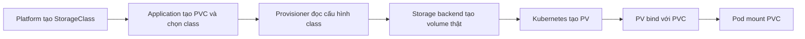
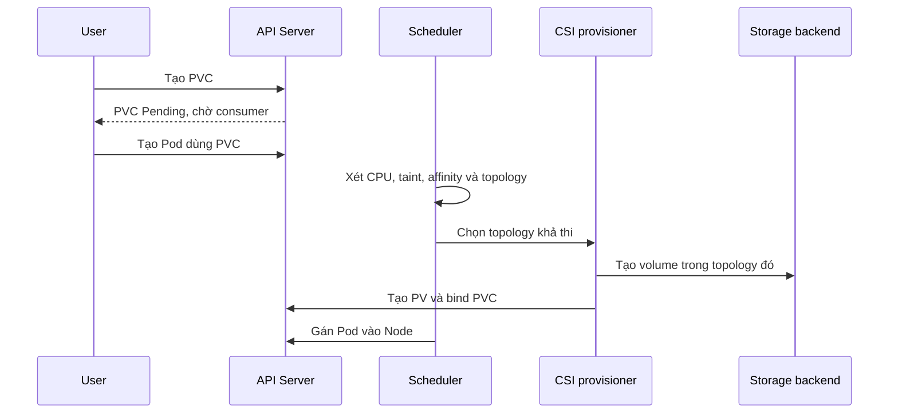

# StorageClass

## Mục lục

- [Tổng quan](#tổng-quan)
- [1. Bài toán StorageClass giải quyết](#1-bài-toán-storageclass-giải-quyết)
- [2. Mental model: StorageClass là mẫu lựa chọn storage](#2-mental-model-storageclass-là-mẫu-lựa-chọn-storage)
- [3. Luồng từ PVC đến dữ liệu của ứng dụng](#3-luồng-từ-pvc-đến-dữ-liệu-của-ứng-dụng)
- [4. Khi nào cần dùng StorageClass](#4-khi-nào-cần-dùng-storageclass)
- [5. Đọc một StorageClass từ ví dụ tối thiểu](#5-đọc-một-storageclass-từ-ví-dụ-tối-thiểu)
- [6. Các field quan trọng trả lời câu hỏi gì](#6-các-field-quan-trọng-trả-lời-câu-hỏi-gì)
- [7. Default StorageClass](#7-default-storageclass)
- [8. Immediate và WaitForFirstConsumer](#8-immediate-và-waitforfirstconsumer)
- [9. Reclaim policy và an toàn dữ liệu](#9-reclaim-policy-và-an-toàn-dữ-liệu)
- [10. StorageClass với static provisioning](#10-storageclass-với-static-provisioning)
- [11. Phân chia trách nhiệm giữa platform và application](#11-phân-chia-trách-nhiệm-giữa-platform-và-application)
- [12. Thực hành quan sát StorageClass](#12-thực-hành-quan-sát-storageclass)
- [13. Thay đổi và migration](#13-thay-đổi-và-migration)
- [14. Troubleshooting theo triệu chứng](#14-troubleshooting-theo-triệu-chứng)
- [15. Checklist lựa chọn StorageClass](#15-checklist-lựa-chọn-storageclass)
- [Tài liệu tham khảo](#tài-liệu-tham-khảo)

---

## Tổng quan

Ứng dụng thường chỉ biết nhu cầu của mình: “tôi cần 20Gi để lưu dữ liệu”. Tuy nhiên, để tạo storage thật còn nhiều câu hỏi khác:

- Dùng SSD, HDD, network filesystem hay local disk?
- Storage nằm ở zone nào để Pod có thể truy cập?
- Có mã hóa, snapshot hoặc cho phép tăng dung lượng không?
- Khi xóa yêu cầu storage, dữ liệu thật phải bị xóa hay được giữ lại?

Không nên bắt mỗi application tự biết tên sản phẩm, API của nhà cung cấp và các chi tiết vận hành đó. Cluster administrator gom các quyết định thành những lựa chọn có tên như `general`, `database` hoặc `shared-rwx`. Mỗi lựa chọn như vậy là một **StorageClass**.

> **Định nghĩa ngắn:** `StorageClass` là API object cấp cluster mô tả **cách Kubernetes nên cấp và quản lý một loại persistent storage**. Application chọn loại đó bằng field `PersistentVolumeClaim.spec.storageClassName`.

Ví dụ, platform có thể công bố:

| Tên StorageClass | Ý nghĩa do platform định nghĩa | Workload phù hợp |
|---|---|---|
| `general` | Storage phổ thông, chi phí vừa phải | Web app, công cụ nội bộ |
| `database` | Block storage có hiệu năng cao, giữ asset khi xóa PVC | Database có dữ liệu quan trọng |
| `shared-rwx` | Filesystem cho nhiều Pod cùng mount | Nội dung hoặc file dùng chung |

Kubernetes không tự quy định `database` phải là SSD hay `general` phải có tốc độ bao nhiêu. Tên và cam kết của từng class do platform team định nghĩa.

Nếu chỉ nhớ bốn điều, hãy nhớ:

1. **StorageClass không phải ổ đĩa và không chứa dữ liệu.** Nó là cấu hình/mẫu để chọn cách cấp storage.
2. **PVC là yêu cầu của application.** PVC chọn StorageClass bằng tên.
3. **Provisioner/CSI driver mới là thành phần tạo volume thật** trên storage backend; sau đó Kubernetes tạo PV để đại diện cho volume đó.
4. **StorageClass quyết định hành vi quan trọng** như thời điểm tạo volume, chính sách xóa và khả năng mở rộng dung lượng.

## 1. Bài toán StorageClass giải quyết

Giả sử ba team cùng yêu cầu PVC 100Gi:

- Team phát triển cần storage rẻ, dữ liệu có thể tạo lại.
- Team database cần latency thấp và không muốn disk bị xóa ngay khi PVC bị xóa nhầm.
- Team xử lý tài liệu cần nhiều Pod trên nhiều Node cùng đọc và ghi file.

Dung lượng `100Gi` không đủ để phân biệt ba nhu cầu. `accessModes` cũng không mô tả đầy đủ tier hiệu năng, mã hóa, topology hay reclaim policy. StorageClass bổ sung lớp lựa chọn đó:

```text
PVC của dev       ── chọn class general    ──> storage phổ thông
PVC của database  ── chọn class database   ──> block storage hiệu năng cao
PVC chia sẻ file  ── chọn class shared-rwx ──> network filesystem
```

Nhờ vậy:

- Application team chọn một **contract có tên**, thay vì cấu hình trực tiếp API của storage vendor.
- Platform team kiểm soát driver, storage tier, topology, mã hóa và lifecycle.
- Dynamic provisioning có thể tạo volume theo nhu cầu, thay vì administrator chuẩn bị thủ công từng PV.

StorageClass tạo abstraction, nhưng không biến mọi backend thành giống nhau. Application vẫn phải chọn đúng `accessModes`, `volumeMode`, dung lượng và kiến trúc dữ liệu phù hợp với capability thực tế của backend.

## 2. Mental model: StorageClass là mẫu lựa chọn storage

Có thể hình dung việc xin storage giống như đặt một mặt hàng từ catalog nội bộ:

| Thành phần | Mental model | Trách nhiệm thật |
|---|---|---|
| StorageClass | Mẫu/catalog item | Mô tả provisioner và policy của một loại storage |
| PVC | Phiếu yêu cầu | Nêu class, dung lượng, access mode và volume mode mà workload cần |
| Provisioner/CSI driver | Bộ phận thực hiện | Gọi storage backend để tạo, xóa hoặc mở rộng volume |
| Storage backend | Nơi chứa hàng thật | Lưu bytes trên cloud disk, SAN, distributed filesystem,... |
| PV | Hồ sơ của volume đã cấp | Đại diện volume thật trong Kubernetes và bind với PVC |
| Pod | Thành phần sử dụng | Mount PVC vào container hoặc dùng dưới dạng raw block device |

Quan hệ cốt lõi là:



### Những điều StorageClass không làm

`StorageClass` **không**:

- Chứa bytes dữ liệu của application.
- Đại diện cho một volume cụ thể; đó là vai trò của PV.
- Yêu cầu một dung lượng cụ thể; đó là field `resources.requests.storage` của PVC.
- Tự động tạo volume chỉ vì object StorageClass tồn tại. Cần có PVC và provisioner tương ứng.
- Tự bảo đảm backup, high availability hoặc hiệu năng chỉ nhờ tên như `gold` hay `fast`.
- Quy định trực tiếp Pod mount vào path nào; Pod cấu hình việc đó qua `volumes` và `volumeMounts`.

> [!IMPORTANT]
> StorageClass là cluster-scoped, còn PVC là namespaced. Một StorageClass có thể được nhiều Namespace chọn nếu policy của cluster cho phép.

## 3. Luồng từ PVC đến dữ liệu của ứng dụng

Luồng phổ biến nhất là **dynamic provisioning**. Giả sử cluster đã có StorageClass tên `general`.

### Bước 1: Application tạo PVC

```yaml
apiVersion: v1
kind: PersistentVolumeClaim
metadata:
  name: app-data
  namespace: production
spec:
  storageClassName: general
  accessModes:
    - ReadWriteOnce
  resources:
    requests:
      storage: 20Gi
```

PVC này nói: “Trong Namespace `production`, tôi cần 20Gi, cách truy cập `ReadWriteOnce`, dùng loại storage `general`.” PVC không nói disk phải được tạo bằng API cloud nào.

### Bước 2: Provisioner xử lý yêu cầu

Provisioner được khai báo trong StorageClass theo dõi PVC phù hợp. Nó đọc:

- Dung lượng và mode từ PVC.
- Driver, parameters, binding mode và reclaim policy từ StorageClass.
- Topology do scheduler chọn nếu class dùng `WaitForFirstConsumer`.

Provisioner sau đó gọi storage backend để tạo volume thật.

### Bước 3: PV được tạo và bind với PVC

Kubernetes tạo một PV đại diện cho volume vừa cấp. PV và PVC chuyển sang trạng thái `Bound` theo quan hệ một-một:

```text
StorageClass general       PVC production/app-data
       │                    class=general, size=20Gi
       └──────────────┬───────────────┘
                      ▼
              provisioner tạo volume
                      ▼
          PV pvc-<uid> ↔ PVC app-data
                      │
                      ▼
               storage backend asset
```

### Bước 4: Pod sử dụng PVC

Pod không tham chiếu trực tiếp StorageClass hay PV. Pod tham chiếu PVC:

```yaml
apiVersion: v1
kind: Pod
metadata:
  name: app
  namespace: production
spec:
  containers:
    - name: app
      image: busybox:1.36
      command: ["sh", "-c", "echo ready >> /data/status; sleep 3600"]
      volumeMounts:
        - name: data
          mountPath: /data
  volumes:
    - name: data
      persistentVolumeClaim:
        claimName: app-data
```

Kubelet và CSI driver thực hiện attach/mount nếu backend yêu cầu. Khi container ghi vào `/data`, bytes được lưu trên volume thật phía backend, không nằm trong object StorageClass.

Luồng chi tiết của controller nằm tại [Dynamic Provisioning](/storage/dynamic-provisioning/). Cách PVC bind và được Pod sử dụng nằm tại [PersistentVolumeClaim](/storage/persistent-volume-claim/).

## 4. Khi nào cần dùng StorageClass

StorageClass hữu ích trong các trường hợp sau:

### Cấp volume tự động theo PVC

Đây là use case phổ biến nhất. User tạo PVC; provisioner tự tạo volume và PV. Administrator không cần chuẩn bị sẵn từng PV cho từng application.

### Cung cấp nhiều lựa chọn storage

Một cluster có thể cần nhiều profile khác nhau:

- Storage rẻ cho dev/test.
- Storage có IOPS cao cho database.
- Filesystem hỗ trợ `ReadWriteMany`.
- Storage zonal hoặc regional.
- Local disk cho workload tự replication và chấp nhận mất Node.

PVC chỉ cần chọn tên class phù hợp.

### Áp dụng policy nhất quán

StorageClass có thể chuẩn hóa:

- Provisioner/CSI driver.
- Tham số tier, filesystem hoặc mã hóa do driver hỗ trợ.
- `Delete` hay `Retain` sau khi PVC bị xóa.
- Tạo volume ngay hay chờ scheduler chọn topology.
- Có cho tăng dung lượng hay không.

### Cung cấp lựa chọn mặc định

Khi cluster có default StorageClass, PVC có thể bỏ `storageClassName`. Kubernetes sẽ gán class mặc định, giúp manifest ứng dụng portable hơn giữa các cluster.

Nếu cluster chỉ có một loại storage, application có thể không cần ghi tên class trong manifest. Tuy vậy, StorageClass mặc định vẫn thường là thành phần đứng sau việc cấp PV động.

## 5. Đọc một StorageClass từ ví dụ tối thiểu

Manifest sau dùng tên provisioner giả để tập trung vào cấu trúc:

```yaml
apiVersion: storage.k8s.io/v1
kind: StorageClass
metadata:
  name: general
provisioner: csi.storage.example.com
parameters:
  type: ssd
  encrypted: "true"
reclaimPolicy: Delete
allowVolumeExpansion: true
volumeBindingMode: WaitForFirstConsumer
```

> [!WARNING]
> Không apply nguyên manifest này. `csi.storage.example.com`, `type` và `encrypted` chỉ là giá trị minh họa. Phải dùng đúng provisioner và parameters trong tài liệu của CSI driver đang cài trên cluster.

Đọc manifest theo thứ tự sau:

1. Class có tên `general`; PVC chọn nó bằng `storageClassName: general`.
2. `csi.storage.example.com` là provisioner chịu trách nhiệm tạo volume.
3. Provisioner nhận hai parameters là `type=ssd` và `encrypted=true`.
4. `WaitForFirstConsumer` trì hoãn tạo/bind volume đến khi có Pod cần PVC, để chọn topology phù hợp.
5. PVC được phép yêu cầu tăng dung lượng vì `allowVolumeExpansion: true`.
6. PV động kế thừa `Delete`; xóa PVC có thể dẫn đến xóa cả volume thật.

Điểm nối giữa PVC và StorageClass chỉ là **tên chính xác**:

```yaml
# StorageClass
metadata:
  name: general
```

```yaml
# PVC
spec:
  storageClassName: general
```

Tên có phân biệt chữ hoa/chữ thường. Nếu PVC ghi `General` trong khi class là `general`, claim sẽ không chọn được class đó.

## 6. Các field quan trọng trả lời câu hỏi gì

Thay vì học thuộc schema, hãy gắn mỗi field với một câu hỏi vận hành.

| Field | Câu hỏi field này trả lời | Nếu không khai báo |
|---|---|---|
| `provisioner` | Thành phần nào tạo volume? | Bắt buộc phải có |
| `parameters` | Driver phải tạo loại volume nào? | Dùng behavior/default của driver |
| `reclaimPolicy` | Xóa PVC thì volume động được giữ hay xóa? | `Delete` |
| `allowVolumeExpansion` | PVC có được tăng dung lượng không? | Không bật expansion |
| `volumeBindingMode` | Tạo/bind volume ngay hay chờ Pod? | `Immediate` |
| `mountOptions` | PV động phải dùng option mount nào? | Không thêm option |
| `allowedTopologies` | Chỉ được cấp volume trong topology nào? | Không giới hạn thêm từ field này |

### Provisioner

`provisioner` là tên driver/provisioner xử lý class:

```yaml
provisioner: csi.storage.example.com
```

Tên này phải khớp driver thật trong cluster. Tạo StorageClass không tự cài driver. Nếu class trỏ tới provisioner không tồn tại hoặc controller của driver không chạy, PVC sẽ `Pending` và có Event provisioning thất bại.

Kiểm tra các CSI driver đã đăng ký:

```bash
kubectl get csidriver
```

### Parameters

`parameters` là map các chuỗi mà Kubernetes chuyển cho provisioner:

```yaml
parameters:
  type: ssd
  encrypted: "true"
```

Tên field, giá trị hợp lệ và default hoàn toàn phụ thuộc driver. Cùng key `type` có thể có nghĩa khác nhau hoặc không được hỗ trợ ở driver khác. Vì vậy:

- Đọc đúng tài liệu của driver và phiên bản đang cài.
- Giữ giá trị dạng string theo schema StorageClass.
- Không đặt credential trực tiếp trong StorageClass; dùng secret reference theo cơ chế của driver.
- Kiểm tra volume thật trên backend để xác nhận tier, encryption và tag đã được áp dụng.

### Allow volume expansion

```yaml
allowVolumeExpansion: true
```

Field này cho phép tăng request dung lượng trên PVC. Nó không tự tăng volume và không bảo đảm mọi lần resize sẽ thành công. CSI driver, backend và filesystem vẫn phải hỗ trợ operation tương ứng.

Kubernetes hỗ trợ **tăng**, không hỗ trợ shrink volume. Quy trình resize nằm tại [PersistentVolumeClaim](/storage/persistent-volume-claim/).

### Mount options

```yaml
mountOptions:
  - noatime
```

Các option này được đưa vào PV động. Kubernetes không kiểm tra option có đúng với filesystem/backend hay không. Một typo hoặc option không được driver hỗ trợ có thể làm provisioning hoặc mount thất bại cho mọi volume mới của class.

Chỉ cấu hình `mountOptions` khi tài liệu driver/backend xác nhận hỗ trợ và đã thử nghiệm trên class canary.

### Allowed topologies

`allowedTopologies` giới hạn nơi provisioner được phép tạo volume, ví dụ chỉ trong hai zone:

```yaml
allowedTopologies:
  - matchLabelExpressions:
      - key: topology.kubernetes.io/zone
        values:
          - zone-a
          - zone-b
```

Không nên thêm giới hạn nếu không có requirement thật. Giới hạn quá hẹp có thể làm Pod không chạy khi các zone đó hết compute hoặc storage capacity.

## 7. Default StorageClass

Administrator có thể đánh dấu một class là mặc định:

```yaml
metadata:
  name: general
  annotations:
    storageclass.kubernetes.io/is-default-class: "true"
```

Khi đó, cách viết `storageClassName` trong PVC tạo ra ba behavior khác nhau:

| Khai báo trong PVC | Ý nghĩa |
|---|---|
| `storageClassName: database` | Chọn chính xác class `database` |
| Không có field `storageClassName` | Dùng default StorageClass nếu có |
| `storageClassName: ""` | Chủ động yêu cầu PV không có class; không dùng default dynamic provisioning |

Ví dụ PVC cho phép cluster chọn default:

```yaml
apiVersion: v1
kind: PersistentVolumeClaim
metadata:
  name: app-data
spec:
  accessModes:
    - ReadWriteOnce
  resources:
    requests:
      storage: 20Gi
```

Kiểm tra default:

```bash
kubectl get storageclass
kubectl get storageclass \
  -o custom-columns=NAME:.metadata.name,DEFAULT:.metadata.annotations.storageclass\.kubernetes\.io/is-default-class,PROVISIONER:.provisioner
```

Platform nên duy trì đúng **một** default class trong trạng thái ổn định. Nếu nhiều class cùng được đánh dấu default, Kubernetes chọn class được tạo gần nhất cho PVC mới không chỉ định `storageClassName`; behavior này hỗ trợ migration, không nên là cấu hình lâu dài.

Nếu PVC được tạo khi chưa có default và field `storageClassName` chưa được đặt, control plane có thể gán default về sau khi default class xuất hiện. PVC khai báo rõ `storageClassName: ""` không nhận việc gán này.

> [!NOTE]
> Đổi default StorageClass không di chuyển dữ liệu của PVC đã `Bound`. Default mới chủ yếu ảnh hưởng PVC mới hoặc PVC chưa được gán class theo behavior defaulting.

## 8. Immediate và WaitForFirstConsumer

`volumeBindingMode` quyết định **khi nào** Kubernetes bind/provision volume.

### Immediate

`Immediate` là default khi field bị bỏ trống. Volume được bind hoặc tạo ngay sau khi PVC xuất hiện, ngay cả khi chưa có Pod.

```text
Tạo PVC
   ↓
Tạo/bind volume ngay
   ↓
Sau đó mới tạo và schedule Pod
```

Behavior này đơn giản nếu storage có thể truy cập từ mọi Node phù hợp. Nhưng với disk chỉ tồn tại trong một zone, provisioner có thể tạo disk ở `zone-a` trước khi biết Pod chỉ có thể chạy ở `zone-b`. Kết quả là PVC đã `Bound` nhưng Pod không schedule được.

### WaitForFirstConsumer

`WaitForFirstConsumer` trì hoãn bind/provision đến khi có Pod thực sự dùng PVC:



Với mode này, PVC `Pending` cùng Event `waiting for first consumer` trước khi có Pod là behavior bình thường, không phải lỗi.

| Chọn mode | Khi phù hợp | Trade-off chính |
|---|---|---|
| `Immediate` | Backend không bị giới hạn theo Node/zone hoặc workflow cần PV sẵn trước Pod | Có thể chọn topology quá sớm |
| `WaitForFirstConsumer` | Zonal disk, local volume hoặc backend topology-constrained | PVC chưa `Bound` cho đến khi scheduler xử lý Pod |

> [!WARNING]
> Không đặt `spec.nodeName` trực tiếp cho Pod dùng PVC với `WaitForFirstConsumer`. Field này bỏ qua scheduler nên PVC có thể tiếp tục `Pending`. Nếu cần giới hạn Node, dùng `nodeSelector` hoặc node affinity để scheduler vẫn tham gia.

`WaitForFirstConsumer` giảm xung đột topology nhưng không tạo thêm capacity. Pod vẫn có thể `Pending` nếu zone phù hợp hết disk quota, hết compute, có taint không được tolerate hoặc driver không báo/không cấp được capacity.

## 9. Reclaim policy và an toàn dữ liệu

`reclaimPolicy` của StorageClass được sao chép vào **PV được dynamic provision** từ class đó.

### Delete

```yaml
reclaimPolicy: Delete
```

Luồng thường là:

```text
Xóa PVC → PV được reclaim → provisioner xóa volume thật → PV biến mất
```

`Delete` giảm orphan volume và chi phí, phù hợp khi dữ liệu có thể tạo lại hoặc đã có backup/guardrail đầy đủ. Nhưng xóa nhầm PVC có thể dẫn đến mất backing volume.

### Retain

```yaml
reclaimPolicy: Retain
```

Khi PVC bị xóa, PV và volume thật được giữ lại để operator xử lý. PV thường chuyển sang `Released` thay vì sẵn sàng cho PVC khác.

`Retain` tạo cơ hội recovery thủ công nhưng cũng tạo trách nhiệm:

- Xác định owner của dữ liệu.
- Giữ chi phí cho volume không còn workload.
- Sanitize dữ liệu trước khi tái sử dụng.
- Có runbook khôi phục hoặc xóa asset trên backend.

> [!IMPORTANT]
> `Retain` không phải backup. Volume vẫn có thể hỏng, bị xóa ngoài Kubernetes hoặc cùng mất với failure domain. Ngược lại, `Delete` không tự động là lựa chọn sai nếu platform có backup, deletion protection và restore test phù hợp.

### Điều gì xảy ra khi xóa từng object

| Thao tác | Tác động thông thường |
|---|---|
| Xóa Pod | PVC, PV và volume thật vẫn tồn tại |
| Xóa PVC | Kích hoạt reclaim lifecycle của PV |
| Xóa StorageClass | Không tự xóa PVC, PV hay volume đã có |
| Đổi default class | Không tự migrate PVC/PV đã `Bound` |

Sau khi StorageClass bị xóa, PVC/PV hiện có tiếp tục mang thông tin đã được ghi vào chúng. Tuy nhiên, PVC mới chọn tên class đã mất thường không thể dynamic provision và sẽ `Pending`, trừ khi có PV tĩnh phù hợp để bind.

Thay `reclaimPolicy` trên StorageClass chỉ ảnh hưởng PV được tạo sau thay đổi. PV đã tồn tại giữ `spec.persistentVolumeReclaimPolicy` hiện tại, trừ khi operator patch từng PV có chủ đích.

## 10. StorageClass với static provisioning

StorageClass thường được nhắc cùng dynamic provisioning, nhưng nó cũng có vai trò trong static provisioning.

Với static provisioning, administrator tạo storage asset và PV trước. PVC sau đó bind với PV phù hợp, trong đó `storageClassName` là một tiêu chí so khớp:

```text
PV tĩnh:  storageClassName=local-storage
PVC:      storageClassName=local-storage
                         ↓
                    Có thể bind nếu size,
              access mode, volume mode,... cũng khớp
```

Ví dụ local PersistentVolume thường dùng class không có automatic provisioner:

```yaml
apiVersion: storage.k8s.io/v1
kind: StorageClass
metadata:
  name: local-storage
provisioner: kubernetes.io/no-provisioner
volumeBindingMode: WaitForFirstConsumer
```

Ở đây:

- `kubernetes.io/no-provisioner` nói rằng Kubernetes không tự tạo local volume.
- Administrator hoặc local volume manager vẫn phải chuẩn bị disk và PV.
- `WaitForFirstConsumer` giúp scheduler chọn PV/Node phù hợp với Pod.

Vì vậy, không nên hiểu StorageClass đồng nghĩa tuyệt đối với “tạo disk tự động”. Dynamic provisioning là use case chính, còn binding policy và phân loại PV tĩnh cũng là use case hợp lệ.

## 11. Phân chia trách nhiệm giữa platform và application

Một ranh giới rõ giúp application portable và giảm cấu hình sai.

### Platform team chịu trách nhiệm

- Cài và vận hành CSI driver/provisioner.
- Tạo StorageClass và chọn default class.
- Định nghĩa ý nghĩa của từng class: backend, failure domain, performance, encryption và chi phí.
- Chọn `volumeBindingMode`, `reclaimPolicy`, expansion và topology.
- Đặt quota, policy cho phép Namespace/team dùng class nào.
- Theo dõi provisioning, attach/mount error, capacity, orphan volume và chi phí.
- Backup/restore capability và runbook theo data classification.

### Application team chịu trách nhiệm

- Chọn class theo requirement đã công bố, không chỉ theo tên “fast”.
- Khai báo dung lượng, `accessModes` và `volumeMode` trong PVC.
- Cho phép override `storageClassName` trong Helm values hoặc deployment config.
- Kiểm tra filesystem permission và cách application ghi dữ liệu.
- Thiết kế replication, consistency và backup ở cấp application khi cần.
- Xác nhận reclaim policy trước khi uninstall hoặc xóa Namespace/PVC.

Một catalog nhỏ và rõ thường dễ dùng hơn nhiều class gần giống nhau:

| Profile ví dụ | Contract cần công bố | Use case ví dụ |
|---|---|---|
| `general-zonal` | Block zonal, chi phí cơ bản, `WaitForFirstConsumer`, `Delete` | Workload phổ thông |
| `database-zonal` | Block zonal hiệu năng cao, expansion, `Retain` | Database tự replication |
| `shared-rwx` | Shared filesystem, latency và quota cụ thể | File dùng chung |
| `local-fast` | Local NVMe, mất Node có thể mất quyền truy cập | Cache/shard tự phục hồi |

Mỗi class nên có tài liệu về access mode được hỗ trợ, failure domain, giới hạn hiệu năng, snapshot/resize, backup coverage, cost và owner xử lý sự cố.

## 12. Thực hành quan sát StorageClass

Phần này chỉ đọc cấu hình hiện có trước, không tạo hay sửa StorageClass của platform.

### Bước 1: Liệt kê các class

```bash
kubectl get storageclass
```

Tên viết tắt tương đương:

```bash
kubectl get sc
```

Quan sát các cột:

- `NAME`: tên PVC phải dùng trong `storageClassName`.
- `PROVISIONER`: driver xử lý class.
- `RECLAIMPOLICY`: `Delete` hay `Retain` cho PV động.
- `VOLUMEBINDINGMODE`: `Immediate` hay `WaitForFirstConsumer`.
- `ALLOWVOLUMEEXPANSION`: class có bật resize hay không.
- Dấu `(default)` cạnh tên: class mặc định.

### Bước 2: Đọc một class cụ thể

```bash
export SC=REPLACE_WITH_STORAGE_CLASS
kubectl get storageclass "$SC" -o yaml
kubectl describe storageclass "$SC"
```

Thay `REPLACE_WITH_STORAGE_CLASS` bằng tên thật từ bước 1. Trả lời sáu câu hỏi:

1. Provisioner nào xử lý class?
2. Parameters nào phụ thuộc vendor?
3. PVC bị xóa thì PV động dùng `Delete` hay `Retain`?
4. Class có cho expansion không?
5. Binding diễn ra ngay hay chờ Pod?
6. Class có giới hạn topology không?

### Bước 3: Trace một PVC đang có

```bash
export NS=REPLACE_WITH_NAMESPACE
export PVC=REPLACE_WITH_PVC

kubectl get pvc "$PVC" -n "$NS" \
  -o custom-columns=NAME:.metadata.name,CLASS:.spec.storageClassName,STATUS:.status.phase,VOLUME:.spec.volumeName,SIZE:.status.capacity.storage
kubectl describe pvc "$PVC" -n "$NS"
```

Lấy tên class và PV từ PVC:

```bash
SC=$(kubectl get pvc "$PVC" -n "$NS" -o jsonpath='{.spec.storageClassName}')
PV=$(kubectl get pvc "$PVC" -n "$NS" -o jsonpath='{.spec.volumeName}')

printf 'StorageClass=%s\nPersistentVolume=%s\n' "$SC" "$PV"
kubectl get storageclass "$SC" -o yaml
kubectl get pv "$PV" -o yaml
```

Trong PV, so sánh:

- `.spec.storageClassName` với class của PVC.
- `.spec.persistentVolumeReclaimPolicy` với class.
- `.spec.csi.driver` với provisioner.
- `.spec.csi.volumeHandle` với asset trên backend.
- `.spec.nodeAffinity` với zone/Node của Pod.

Đây là cách nối mental model thành object thật:

```text
PVC → StorageClass → provisioner
  └→ PV → CSI volumeHandle → storage backend asset
```

> [!NOTE]
> Nếu PVC chưa `Bound`, biến `PV` có thể rỗng. Hãy đọc Events trong `kubectl describe pvc` trước; PVC có thể đang chờ first consumer hoặc provisioning đang lỗi.

### Bước 4: Quan sát một lần dynamic provisioning

Prerequisite: cluster có một StorageClass hỗ trợ dynamic provisioning và bạn được phép tạo PVC. Tạo file `storage-class-demo.yaml`, thay placeholder bằng class đã chọn:

```yaml
apiVersion: v1
kind: Namespace
metadata:
  name: storage-class-lab
---
apiVersion: v1
kind: PersistentVolumeClaim
metadata:
  name: demo-data
  namespace: storage-class-lab
spec:
  storageClassName: REPLACE_WITH_STORAGE_CLASS
  accessModes:
    - ReadWriteOnce
  resources:
    requests:
      storage: 1Gi
---
apiVersion: v1
kind: Pod
metadata:
  name: demo-consumer
  namespace: storage-class-lab
spec:
  containers:
    - name: app
      image: busybox:1.36
      command: ["sh", "-c", "echo storage-class-ok > /data/status; sleep 3600"]
      volumeMounts:
        - name: data
          mountPath: /data
  volumes:
    - name: data
      persistentVolumeClaim:
        claimName: demo-data
```

Apply và quan sát:

```bash
kubectl apply -f storage-class-demo.yaml
kubectl get pod,pvc -n storage-class-lab -w
```

Khi Pod `Ready`, kiểm tra data và trace PV:

```bash
kubectl exec demo-consumer -n storage-class-lab -- cat /data/status
PV=$(kubectl get pvc demo-data -n storage-class-lab -o jsonpath='{.spec.volumeName}')
kubectl get pv "$PV" \
  -o custom-columns=NAME:.metadata.name,CLASS:.spec.storageClassName,RECLAIM:.spec.persistentVolumeReclaimPolicy,DRIVER:.spec.csi.driver
```

Expected result:

- PVC chuyển sang `Bound`.
- Pod chuyển sang `Running`/`Ready`.
- File `/data/status` chứa `storage-class-ok`.
- PV có class, reclaim policy và CSI driver tương ứng.

Trước cleanup, đọc lại reclaim policy:

```bash
kubectl get pv "$PV" \
  -o custom-columns=NAME:.metadata.name,RECLAIM:.spec.persistentVolumeReclaimPolicy,HANDLE:.spec.csi.volumeHandle
```

Sau khi xác nhận dữ liệu lab không cần giữ:

```bash
kubectl delete namespace storage-class-lab
```

Nếu policy là `Retain`, PV/backend asset có thể còn lại và cần được dọn theo runbook của platform. Lab này chứng minh provisioning và mount hoạt động; nó không chứng minh backup, multi-zone durability hay hiệu năng production.

## 13. Thay đổi và migration

StorageClass là contract mà nhiều PVC có thể phụ thuộc. Không nên chỉnh một class đang dùng chỉ để thay đổi behavior âm thầm. Một số field cũng bị giới hạn cập nhật bởi API/driver.

Khi thay đổi lớn về tier, parameters, reclaim policy hoặc binding mode, cách an toàn thường là:

1. Tạo class mới với tên/version mới, ví dụ `database-v2`.
2. Tạo PVC và workload canary dùng class mới.
3. Kiểm tra provisioning, attach, mount, expansion, snapshot/restore và failure behavior.
4. Với dữ liệu hiện có, tạo volume đích bằng snapshot, clone, backup/restore hoặc replication ở cấp application.
5. Dừng hoặc quiesce writer theo consistency requirement rồi cut over.
6. Xác minh dữ liệu, permission, capacity và performance.
7. Giữ rollback point trong retention window đã định.
8. Chỉ retire class và asset cũ sau khi inventory không còn dependency.

PVC đã `Bound` không tự đổi sang storage khác khi:

- Sửa StorageClass.
- Tạo class mới.
- Đổi default class.
- Thử sửa `storageClassName` trong manifest workload.

Storage migration là quá trình di chuyển dữ liệu, không chỉ là đổi tên class.

## 14. Troubleshooting theo triệu chứng

Bắt đầu bằng object và Events, không bắt đầu bằng restart hoặc xóa PVC:

```bash
kubectl get pvc PVC -n NS -o wide
kubectl describe pvc PVC -n NS
kubectl get storageclass
kubectl get events -n NS --sort-by=.lastTimestamp
```

### PVC báo StorageClass không tồn tại

Dấu hiệu thường thấy là Event có nội dung `storageclass ... not found`.

```bash
kubectl get pvc PVC -n NS -o jsonpath='{.spec.storageClassName}{"\n"}'
kubectl get storageclass
```

Kiểm tra exact name và chữ hoa/chữ thường. Sửa Helm values hoặc manifest để chọn class thật. Không tạo một class giả cùng tên nếu chưa biết provisioner và policy đúng.

### PVC Pending và báo waiting for first consumer

Nếu class dùng `WaitForFirstConsumer`, đây có thể là behavior đúng. Kiểm tra đã có Pod tham chiếu PVC chưa:

```bash
kubectl describe pvc PVC -n NS
kubectl describe pod POD -n NS
```

Nếu Pod đã tồn tại, đọc scheduler Events và kiểm tra:

- CPU/memory request.
- `nodeSelector`, affinity và anti-affinity.
- Taint/toleration.
- Zone còn compute và storage capacity.
- Pod có đặt `spec.nodeName` trực tiếp hay không.

### Provisioning timeout hoặc thất bại

```bash
kubectl describe pvc PVC -n NS
kubectl get storageclass SC -o yaml
kubectl get csidriver
kubectl get pods -A -o wide | grep -iE 'csi|provisioner|storage'
```

Từ Event, xác định đúng CSI controller rồi kiểm tra log trong time window xảy ra lỗi. Nguyên nhân thường gồm:

- Provisioner không chạy hoặc sai tên.
- Credential/secret reference lỗi.
- Parameters không hợp lệ.
- Backend hết quota/capacity.
- API storage timeout hoặc rate limit.
- Topology không còn lựa chọn phù hợp.

### PVC Bound nhưng Pod không chạy

`Bound` chỉ chứng minh PVC đã nối với PV. Attach và mount vẫn có thể lỗi:

```bash
kubectl describe pod POD -n NS
kubectl get volumeattachment
kubectl get pv PV -o yaml
```

Kiểm tra zone/node affinity, stale attachment, attach limit, CSI node plugin, filesystem, mount option và permission. Không force detach khi writer cũ có thể vẫn hoạt động vì hai writer có thể làm hỏng dữ liệu.

### PVC không tăng dung lượng

Kiểm tra class và driver trước:

```bash
kubectl get storageclass SC \
  -o custom-columns=NAME:.metadata.name,EXPAND:.allowVolumeExpansion,PROVISIONER:.provisioner
kubectl describe pvc PVC -n NS
```

Các khả năng chính:

- `allowVolumeExpansion` chưa bật.
- Driver/backend/filesystem không hỗ trợ kiểu expansion cần thiết.
- Request mới vượt quota hoặc giới hạn backend.
- Controller expansion xong nhưng node/filesystem expansion còn chờ.

Không sửa trực tiếp `PV.spec.capacity` và không cố shrink PVC.

### Volume tạo ở sai zone hoặc Pod báo volume node affinity conflict

```bash
kubectl get storageclass SC -o yaml
kubectl get pv PV -o jsonpath='{.spec.nodeAffinity}{"\n"}'
kubectl describe pod POD -n NS
kubectl get nodes -L topology.kubernetes.io/zone
```

So sánh `volumeBindingMode`, PV node affinity và scheduling constraints của Pod. Nếu class dùng `Immediate` cho zonal storage, thiết kế class mới với `WaitForFirstConsumer` cho volume mới. Việc đổi class không tự di chuyển volume hiện tại.

### Xóa PVC nhưng volume vẫn còn

Kiểm tra reclaim policy trên **PV**, vì đây là policy áp dụng cho volume cụ thể:

```bash
kubectl get pv PV \
  -o custom-columns=NAME:.metadata.name,PHASE:.status.phase,RECLAIM:.spec.persistentVolumeReclaimPolicy,HANDLE:.spec.csi.volumeHandle
```

- `Retain`: asset còn lại là behavior dự kiến; thực hiện recovery/sanitize/delete theo runbook.
- `Delete`: kiểm tra finalizer, CSI provisioner log, credential và backend API.

Không xóa finalizer chỉ để object biến mất trước khi map được `volumeHandle` với asset thật.

## 15. Checklist lựa chọn StorageClass

### Cho application owner

- [ ] Class này dùng backend nào và failure domain là Node, zone hay region?
- [ ] Class hỗ trợ đúng `accessModes` và `volumeMode` mà application cần không?
- [ ] Hiệu năng, latency, quota và chi phí đã phù hợp chưa?
- [ ] `volumeBindingMode` có phù hợp topology của workload không?
- [ ] Xóa PVC sẽ `Delete` hay `Retain` volume?
- [ ] Có hỗ trợ expansion, snapshot và restore không?
- [ ] Backup do platform hay application chịu trách nhiệm?
- [ ] Helm chart/deployment config có cho override tên class giữa các cluster không?

### Cho platform owner

- [ ] Provisioner và CSI driver version tương thích Kubernetes version.
- [ ] Chỉ có một default class an toàn ở trạng thái ổn định.
- [ ] Zonal/local storage dùng `WaitForFirstConsumer` khi phù hợp.
- [ ] Mỗi class có contract rõ về capability, performance, topology và cost.
- [ ] Reclaim policy khớp data classification và có runbook cleanup/recovery.
- [ ] Encryption, KMS, parameters và backend tags đã được xác minh trên asset thật.
- [ ] Quota và capacity được theo dõi theo class và zone.
- [ ] Provisioning, attach, mount, expansion và restore đã được test end-to-end.
- [ ] Thay đổi lớn dùng class mới và canary thay vì sửa contract âm thầm.

## Tài liệu tham khảo

- [Storage Classes](https://kubernetes.io/docs/concepts/storage/storage-classes/)
- [Dynamic Volume Provisioning](https://kubernetes.io/docs/concepts/storage/dynamic-provisioning/)
- [Persistent Volumes](https://kubernetes.io/docs/concepts/storage/persistent-volumes/)
- [PersistentVolume](/storage/persistent-volume/)
- [PersistentVolumeClaim](/storage/persistent-volume-claim/)
- [Dynamic Provisioning](/storage/dynamic-provisioning/)
- [Container Storage Interface](/storage/csi/)
