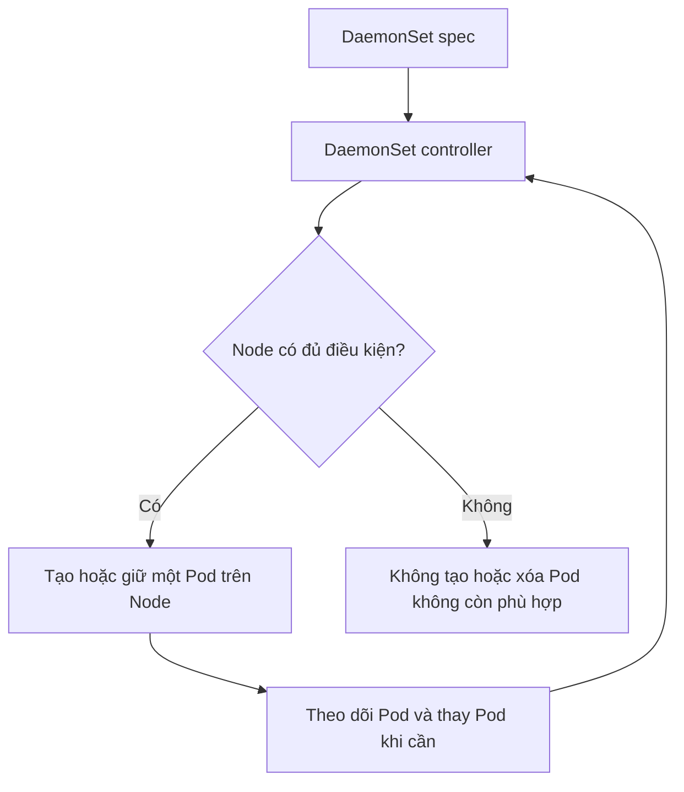

# DaemonSet

## Mục lục

- [DaemonSet là gì?](#daemonset-là-gì)
- [DaemonSet khác Deployment như thế nào?](#daemonset-khác-deployment-như-thế-nào)
- [DaemonSet hoạt động ra sao?](#daemonset-hoạt-động-ra-sao)
- [Manifest DaemonSet tối thiểu](#manifest-daemonset-tối-thiểu)
- [Chọn những Node được chạy Pod](#chọn-những-node-được-chạy-pod)
- [Taints và tolerations](#taints-và-tolerations)
- [Cập nhật và rollback](#cập-nhật-và-rollback)
- [Tài nguyên và quyền truy cập Node](#tài-nguyên-và-quyền-truy-cập-node)
- [Thực hành](#thực-hành)
- [Troubleshooting](#troubleshooting)
- [Best practices](#best-practices)
- [Tóm tắt](#tóm-tắt)
- [Tài liệu tham khảo](#tài-liệu-tham-khảo)

---

## DaemonSet là gì?

`DaemonSet` là một Kubernetes controller dùng để chạy **một Pod trên mỗi Node phù hợp**.

Giả sử cluster có ba Node:

```text
Cluster
├── node-a ── node-agent-abc
├── node-b ── node-agent-def
└── node-c ── node-agent-ghi
```

Khi thêm `node-d`, DaemonSet tự tạo một Pod hướng tới `node-d`; Pod chỉ chạy được nếu vượt qua các điều kiện scheduling. Khi một Node bị xóa khỏi cluster, Pod của DaemonSet trên Node đó cũng được dọn theo. Nếu một Pod bị xóa, DaemonSet tạo Pod thay thế trên cùng Node. Nếu chỉ container bên trong bị lỗi, kubelet thường restart container trong chính Pod đó theo `restartPolicy: Always`; DaemonSet không cần tạo Pod mới cho trường hợp này.

> [!IMPORTANT]
> DaemonSet không scale bằng `spec.replicas`. Số Pod của nó phụ thuộc vào số Node thỏa điều kiện chạy. Thêm Node đồng nghĩa với thêm một bản sao của Pod và thêm chi phí CPU, memory, network hoặc storage.

### Các trường hợp sử dụng phổ biến

DaemonSet phù hợp với workload cần hiện diện ở cấp Node, chẳng hạn:

- **Log collection:** đọc log container hoặc log trên host rồi gửi đến hệ thống tập trung.
- **Node monitoring:** thu thập CPU, memory, disk, network và các metric của từng Node.
- **Networking:** chạy thành phần networking hoặc kube-proxy trên từng Node.
- **Storage:** chạy CSI node plugin để kết nối volume với Node.
- **Security:** chạy agent phát hiện hành vi bất thường hoặc kiểm tra runtime.
- **Node preparation:** pre-pull image hoặc chạy một agent cấu hình trên một nhóm Node.

DaemonSet chỉ cung cấp lifecycle và placement cho Pod. Nó không tự biến ba Pod thành một cluster có replication, leader election hay failover.

## DaemonSet khác Deployment như thế nào?

Cả `Deployment` và `DaemonSet` đều quản lý các Pod chạy lâu dài, tự tạo Pod thay thế và hỗ trợ rollout. Khác biệt là tiêu chí quyết định Pod chạy ở đâu.

| Câu hỏi | Deployment | DaemonSet |
|---|---|---|
| Mục tiêu chính | Chạy một số replica của ứng dụng | Chạy một Pod trên mỗi Node phù hợp |
| Cấu hình số Pod | `spec.replicas` | Số Node đủ điều kiện |
| Pod có cần ở đúng Node không? | Thường không | Có, mỗi Node cần một bản sao |
| Ví dụ | Web, API, worker stateless | Log agent, node exporter, CSI node plugin |
| Khi thêm Node | Không tự tăng replica nếu chưa scale | Tự tạo Pod trên Node mới |
| Khi nào nên dùng? | Các replica thay thế lẫn nhau | Workload cung cấp chức năng gần Node |

Ví dụ:

- API web có `replicas: 3` không cần quan tâm Pod nằm trên `node-a` hay `node-b`; dùng `Deployment`.
- Log agent cần đọc log trên **từng** Node; dùng `DaemonSet`.
- Worker chỉ cần tổng cộng 10 bản sao, không cần phủ tất cả Node; dùng `Deployment`, không dùng DaemonSet.

## DaemonSet hoạt động ra sao?

### Desired state và reconciliation

Bạn khai báo rằng mỗi Node phù hợp phải có một Pod. DaemonSet controller liên tục so sánh mong muốn đó với trạng thái thực tế:



DaemonSet trước hết xác định tập Node mục tiêu bằng `nodeSelector` hoặc `nodeAffinity` trong Pod template. Sau đó Scheduler mới kiểm tra các điều kiện để Pod có thể chạy thực tế, chẳng hạn:

- Taints của Node và tolerations của Pod.
- CPU, memory, volume, port và các constraint scheduling khác.
- OS, architecture hoặc yêu cầu phần cứng của image/workload.

Nếu không đặt `nodeSelector` hoặc `nodeAffinity`, DaemonSet sẽ nhắm đến mọi Node. Tuy nhiên, Pod trên một Node cụ thể vẫn có thể bị `Pending` hoặc không được schedule nếu không tolerate taint, thiếu tài nguyên hoặc vi phạm constraint khác.

### Ai quyết định Pod chạy trên Node nào?

DaemonSet controller xác định rằng Node nào cần có Pod và tạo một Pod hướng tới Node đó. Scheduler sau đó kiểm tra các ràng buộc scheduling rồi bind Pod vào Node. Vì vậy, DaemonSet không chỉ là “tạo nhiều Pod”; mỗi Pod được gắn với một Node cụ thể.

Luồng đơn giản:

```text
1. DaemonSet đọc selector/affinity và danh sách Node.
2. Controller phát hiện node-b còn thiếu Pod.
3. Controller tạo Pod từ spec.template cho node-b.
4. Scheduler kiểm tra resource, taint, affinity và các constraint.
5. Kubelet trên node-b kéo image và chạy container.
6. DaemonSet cập nhật status: desired, current, ready, updated...
```

Nếu Node không đủ tài nguyên hoặc Pod không thể chạy vì taint, DaemonSet vẫn có thể đã tạo Pod nhưng Pod sẽ ở `Pending`. Điều này khác với việc DaemonSet không xem Node đó là eligible.

### Những status field cần biết

```bash
kubectl get daemonset <name> -n <namespace>
kubectl get daemonset <name> -n <namespace> -o yaml
```

| Field | Ý nghĩa |
|---|---|
| `desiredNumberScheduled` | Số Node mà DaemonSet muốn chạy Pod |
| `currentNumberScheduled` | Số Node hiện đang có Pod của DaemonSet |
| `numberReady` | Số Pod đang `Ready` |
| `numberAvailable` | Số Pod đạt điều kiện `Available` |
| `updatedNumberScheduled` | Số Pod đã dùng Pod template mới |
| `numberMisscheduled` | Số Pod đang chạy trên Node không còn phù hợp |

`desiredNumberScheduled` và `numberReady` có thể khác nhau. DaemonSet có thể đã tạo đủ Pod nhưng một số Pod đang pull image, Pending, crash hoặc chưa qua readiness probe.

## Manifest DaemonSet tối thiểu

Manifest sau chạy một agent đơn giản trên mỗi Node phù hợp. Agent chỉ in tên Node và thời gian mỗi 30 giây; nó không cần quyền truy cập host nên an toàn hơn cho lab.

```yaml
apiVersion: apps/v1
kind: DaemonSet
metadata:
  name: node-agent
  namespace: daemon-lab
  labels:
    app.kubernetes.io/name: node-agent
    app.kubernetes.io/component: node-agent
spec:
  selector:
    matchLabels:
      app: node-agent
  updateStrategy:
    type: RollingUpdate
    rollingUpdate:
      maxUnavailable: 1
  template:
    metadata:
      labels:
        app: node-agent
    spec:
      terminationGracePeriodSeconds: 10
      containers:
        - name: agent
          image: busybox:1.36
          command:
            - sh
            - -c
            - |
              while true; do
                echo "node=$NODE_NAME hostname=$HOSTNAME time=$(date -Iseconds)"
                sleep 30
              done
          env:
            - name: NODE_NAME
              valueFrom:
                fieldRef:
                  fieldPath: spec.nodeName
          resources:
            requests:
              cpu: 10m
              memory: 16Mi
            limits:
              memory: 32Mi
```

### Đọc manifest theo từng phần

#### `spec.selector` và `template.metadata.labels`

```yaml
selector:
  matchLabels:
    app: node-agent
template:
  metadata:
    labels:
      app: node-agent
```

`selector` nói cho DaemonSet biết Pod nào thuộc về nó. Selector phải khớp với label trong Pod template. Nếu hai phần không khớp, API Server từ chối manifest.

Selector của DaemonSet không thể sửa sau khi object được tạo. Hãy chọn selector cụ thể và ổn định ngay từ đầu; selector quá chung có thể overlap với workload khác.

#### `spec.template`

`spec.template` là mẫu của một Pod. Các field bên trong gần như giống Pod thông thường, nhưng không lặp lại `apiVersion` và `kind`:

- `containers` mô tả image và process cần chạy.
- `resources` giúp Scheduler tính capacity và giới hạn memory runtime.
- `env.fieldRef.spec.nodeName` đưa tên Node vào container.
- `terminationGracePeriodSeconds` cho agent thời gian dừng và flush dữ liệu.

Pod do DaemonSet tạo phải có `restartPolicy: Always`, hoặc bỏ qua field này vì giá trị mặc định là `Always`. DaemonSet dành cho process chạy liên tục; task chạy xong nên dùng [Job](/workloads/job/).

#### Vì sao chỉ dùng `spec.nodeName` khi thật sự cần?

Trong manifest trên, container đọc `spec.nodeName` qua Downward API để in tên Node. Ứng dụng thường không nên tự gắn cứng `spec.nodeName` trong Pod template. DaemonSet controller và scheduler cần tự xử lý placement; việc gắn cứng tên Node sẽ làm mất tính linh hoạt và có thể khiến workload không chạy khi Node đó biến mất.

## Chọn những Node được chạy Pod

Mặc định DaemonSet nhắm đến mọi Node. Bạn có thể thu hẹp tập Node bằng `nodeSelector` hoặc `nodeAffinity`.

### `nodeSelector`: lựa chọn đơn giản

Trước tiên gắn label vào các Node dành cho agent:

```bash
kubectl label node node-a node-b node-role.example.com=observability
```

Sau đó thêm vào Pod template:

```yaml
spec:
  template:
    spec:
      nodeSelector:
        node-role.example.com: observability
```

DaemonSet chỉ tạo Pod trên Node có đúng label này. Nếu không có Node nào match, `desiredNumberScheduled` có thể bằng `0`.

### `nodeAffinity`: điều kiện linh hoạt hơn

Dùng `nodeAffinity` khi cần nhiều giá trị hoặc nhiều điều kiện:

```yaml
spec:
  template:
    spec:
      affinity:
        nodeAffinity:
          requiredDuringSchedulingIgnoredDuringExecution:
            nodeSelectorTerms:
              - matchExpressions:
                  - key: kubernetes.io/arch
                    operator: In
                    values:
                      - amd64
                      - arm64
                  - key: workload.example.com/pool
                    operator: In
                    values:
                      - general
                      - observability
```

`requiredDuringSchedulingIgnoredDuringExecution` là điều kiện bắt buộc lúc schedule. Phần `IgnoredDuringExecution` nghĩa là thay đổi label sau khi Pod đã chạy không nhất thiết evict Pod ngay.

Có thể dùng `preferredDuringSchedulingIgnoredDuringExecution` cho preference mềm. Với DaemonSet, nếu Node đã được xác định là eligible nhưng không đủ tài nguyên hoặc vi phạm constraint khác, Pod vẫn có thể Pending.

### Label dùng cho security placement

Không nên tin một label tùy ý nếu label đó quyết định workload nhạy cảm chạy ở đâu. Trong threat model có Node bị compromise, kubelet trên Node có thể tự sửa một số label. Khi cần isolation, dùng label có prefix được bảo vệ bởi `NodeRestriction` và bật cơ chế đó trong cluster, ví dụ:

```text
example.com.node-restriction.kubernetes.io/fips=true
```

Label chỉ giúp chọn Node; nó không thay thế security boundary, admission policy hoặc cơ chế hardening của Node.

## Taints và tolerations

`nodeSelector`/affinity **thu hút** Pod về Node. Taint **đẩy** Pod ra khỏi Node. Toleration cho phép Pod chịu được một taint, nhưng toleration không đảm bảo Pod chắc chắn được schedule: resource, affinity, volume và các điều kiện khác vẫn phải hợp lệ.

### Ví dụ Node có taint

```bash
kubectl taint node node-a dedicated=observability:NoSchedule
```

Pod không có toleration tương ứng sẽ không được schedule mới lên `node-a`. Để DaemonSet chạy trên Node này, thêm toleration vào Pod template:

```yaml
spec:
  template:
    spec:
      tolerations:
        - key: dedicated
          operator: Equal
          value: observability
          effect: NoSchedule
```

Ba effect thường gặp:

| Effect | Tác dụng |
|---|---|
| `NoSchedule` | Không schedule Pod mới nếu Pod không tolerate taint |
| `PreferNoSchedule` | Cố gắng tránh schedule, nhưng không phải quy tắc tuyệt đối |
| `NoExecute` | Pod đang chạy có thể bị evict nếu không tolerate; Pod mới cũng không được schedule |

### DaemonSet tự thêm một số toleration

Kubernetes tự thêm một số toleration đặc biệt cho Pod của DaemonSet để node-level agent không biến mất chỉ vì Node đang có vấn đề. Các ví dụ gồm taint về `memory-pressure`, `disk-pressure`, `pid-pressure` và `unschedulable`; Pod `DaemonSet` cũng có toleration `NoExecute` cho `not-ready` và `unreachable`.

Điều này **không có nghĩa DaemonSet tự tolerate mọi taint**. Taint tùy chỉnh như `dedicated=observability:NoSchedule` hoặc taint control-plane thường vẫn cần toleration rõ ràng:

```yaml
spec:
  template:
    spec:
      tolerations:
        - key: node-role.kubernetes.io/control-plane
          operator: Exists
          effect: NoSchedule
```

Chỉ thêm toleration control-plane nếu agent thực sự cần chạy ở đó. Toleration quá rộng như sau có thể cho phép agent chạy trên mọi Node có taint, kể cả Node dành riêng cho workload khác:

```yaml
# Tránh dùng nếu không có lý do rõ ràng.
- operator: Exists
```

### Toleration không thay thế node selection

Nếu Node có taint `dedicated=observability:NoSchedule`, thêm toleration chỉ có nghĩa “Pod được phép vào Node đó”. Nó **không** ngăn Pod chạy trên các Node khác.

Nếu muốn agent chỉ chạy trong pool observability, dùng cả hai:

```yaml
spec:
  template:
    spec:
      nodeSelector:
        workload.example.com/pool: observability
      tolerations:
        - key: dedicated
          operator: Equal
          value: observability
          effect: NoSchedule
```

Có thể nhớ như sau:

```text
nodeSelector/affinity = Pod được phép hoặc muốn chạy ở đâu?
toleration            = Pod chịu được taint nào?
resource/scheduling   = Pod có thực sự chạy được ở đó không?
```

## Cập nhật và rollback

### `RollingUpdate`

`RollingUpdate` là strategy mặc định. Khi Pod template thay đổi, DaemonSet lần lượt thay Pod trên các Node theo giới hạn `maxUnavailable`.

Ví dụ cluster có ba Node và `maxUnavailable: 1`:

```text
Bắt đầu:  node-a old | node-b old | node-c old
Bước 1:  node-a new | node-b old | node-c old
Bước 2:  node-a new | node-b new | node-c old
Kết thúc: node-a new | node-b new | node-c new
```

Kubernetes không nhất thiết update đúng theo thứ tự `node-a`, `node-b`, `node-c`; thứ tự cụ thể không nên là dependency của ứng dụng.

`maxUnavailable` có thể là số Pod hoặc phần trăm. Giá trị càng lớn thì rollout nhanh hơn nhưng càng nhiều Node tạm thời không có agent. Với network, storage, security hoặc monitoring agent quan trọng, nên bắt đầu bằng batch nhỏ và kiểm tra health sau mỗi thay đổi.

Theo dõi rollout:

```bash
kubectl rollout status daemonset/node-agent \
  -n daemon-lab --timeout=5m

kubectl rollout history daemonset/node-agent -n daemon-lab
kubectl get daemonset,pods -n daemon-lab -o wide
```

Một Pod mới chỉ được tính là sẵn sàng khi container và readiness signal của nó đáp ứng điều kiện. Nếu image lỗi, probe lỗi hoặc dependency host không hoạt động, rollout có thể dừng lâu hơn timeout của pipeline.

### `OnDelete`

Với `OnDelete`, DaemonSet cập nhật template nhưng không tự thay Pod đang chạy. Pod mới chỉ xuất hiện khi Pod cũ bị xóa:

```yaml
spec:
  updateStrategy:
    type: OnDelete
```

Strategy này cho phép operator kiểm soát từng Node, nhưng dễ để các Node chạy nhiều version khác nhau. Chỉ dùng khi có quy trình update thủ công rõ ràng.

### Rollback

Rollback DaemonSet về revision trước:

```bash
kubectl rollout undo daemonset/node-agent -n daemon-lab
kubectl rollout status daemonset/node-agent \
  -n daemon-lab --timeout=5m
```

Rollback chỉ thay đổi desired state trong cluster. Nếu manifest trong Git hoặc hệ thống GitOps vẫn chứa image/config lỗi, lần reconcile tiếp theo có thể đưa lỗi trở lại. Sau incident, cập nhật source of truth và ghi nhận nguyên nhân.

### Xóa DaemonSet

Xóa DaemonSet theo cách thông thường sẽ xóa các Pod do nó tạo:

```bash
kubectl delete daemonset node-agent -n daemon-lab
```

`--cascade=orphan` có thể giữ Pod lại nhưng Pod sẽ không còn controller duy trì. Đây là thao tác migration nâng cao, không nên dùng như cleanup thông thường.

## Tài nguyên và quyền truy cập Node

### Tính overhead theo toàn bộ Node

Requests của DaemonSet được nhân với số Node phù hợp:

```text
100 Node × 100m CPU   = 10 CPU request
100 Node × 200Mi RAM  = 20,000Mi ≈ 19.5Gi RAM request
```

Nếu chạy năm agent trên cùng fleet, cần cộng requests của cả năm agent. Khi thêm Node, tổng overhead tự tăng. Vì vậy hãy xem DaemonSet là một phần của platform capacity, không phải một Pod nhỏ lẻ.

Nên khai báo `requests` và `limits` phù hợp với mức sử dụng thật. Request quá thấp làm Node bị overcommit; request quá cao khiến Pod không schedule được dù agent thực tế dùng ít tài nguyên.

### Host access làm tăng blast radius

Agent cấp Node thường cần một hoặc nhiều quyền sau:

- `hostPath` để đọc `/var/log`, `/var/lib/...` hoặc socket của runtime.
- `hostNetwork` để dùng network namespace của host.
- `hostPID` để quan sát process trên host.
- `privileged` hoặc Linux capabilities đặc biệt.
- ServiceAccount và RBAC để đọc tài nguyên cluster.

Mỗi quyền mở rộng đều làm tác động của image hoặc process bị compromise lớn hơn. Ví dụ `hostPath` trỏ tới `/` với quyền ghi có thể cho phép sửa filesystem của host.

Giảm rủi ro bằng cách:

- Chỉ mount đúng path cần dùng.
- Dùng `readOnly: true` khi agent chỉ đọc.
- Chạy non-root và drop capabilities nếu agent hỗ trợ.
- Tránh `privileged`, `hostPID` và `hostNetwork` nếu không bắt buộc.
- Dùng ServiceAccount riêng với RBAC tối thiểu.
- Scan, sign và pin image bằng digest khi phù hợp.
- Áp admission policy để giới hạn `hostPath`, capabilities và privileged container.
- Xác định rõ Node nào được phép chạy agent bằng label, taint và policy.

Một DaemonSet đọc log host không nên mặc nhiên có quyền ghi toàn bộ host filesystem.

### Priority và drain

Nếu agent là thành phần cần có mặt để Node hoạt động, có thể cần `PriorityClass` cao để Pod được schedule trong lúc Node thiếu capacity. Priority cao có thể preempt application Pod, vì vậy phải cân nhắc blast radius và đặt resource request hợp lý.

Khi bảo trì Node:

```bash
kubectl drain <node> --ignore-daemonsets --delete-emptydir-data
```

`kubectl drain` thường bỏ qua Pod do DaemonSet quản lý và yêu cầu `--ignore-daemonsets` để tiếp tục. Drain không tạo ra một DaemonSet Pod trên Node khác để bù; DaemonSet chỉ đảm bảo Pod trên các Node còn đủ điều kiện. Hãy kiểm tra coverage sau khi cordon, drain và uncordon Node.

## Thực hành

Lab này chạy một `node-agent` không có host access. Vì vậy có thể thực hiện trên cluster học tập mà không cần cấp quyền đặc biệt.

### Điều kiện trước khi bắt đầu

- Có một Kubernetes cluster đang hoạt động.
- `kubectl` đã cài đặt và trỏ đúng context.
- Có quyền tạo Namespace và workload trong cluster.

Kiểm tra context trước khi chạy lệnh:

```bash
kubectl config current-context
kubectl get nodes -o wide
```

> [!WARNING]
> Các lệnh dưới đây tạo và xóa tài nguyên trong context hiện tại. Luôn kiểm tra `kubectl config current-context`, đặc biệt trước khi dùng `kubectl delete namespace`.

### 1. Tạo Namespace và áp dụng manifest

Lưu manifest ở phần trên thành file `daemonset.yaml`, sau đó chạy:

```bash
kubectl create namespace daemon-lab
kubectl apply --dry-run=server -f daemonset.yaml
kubectl apply -f daemonset.yaml
```

`--dry-run=server` gửi manifest tới API Server để kiểm tra schema và validation nhưng không lưu object.

### 2. Xác minh mỗi Node có một Pod

```bash
kubectl rollout status daemonset/node-agent \
  -n daemon-lab --timeout=180s

kubectl get daemonset node-agent -n daemon-lab
kubectl get pods -n daemon-lab -o wide
```

Output minh họa:

```text
NAME         DESIRED   CURRENT   READY   UP-TO-DATE   AVAILABLE
node-agent   3         3         3       3            3
```

Tên và số cột có thể khác theo phiên bản `kubectl`; điều quan trọng là mỗi Node phù hợp có một Pod `Ready`.

So sánh Node và Pod:

```bash
kubectl get nodes --no-headers | wc -l
kubectl get pods -n daemon-lab \
  -l app=node-agent \
  -o custom-columns='POD:.metadata.name,NODE:.spec.nodeName,READY:.status.containerStatuses[0].ready,PHASE:.status.phase'
```

Xem log từ tất cả Pod:

```bash
kubectl logs -n daemon-lab -l app=node-agent --prefix --tail=20
```

Trong log, `node=...` cho biết Node mà Pod đang chạy. `hostname` của Pod thường khác tên Node; đừng dùng hai giá trị này thay thế cho nhau.

### 3. Quan sát self-healing

Chọn một Pod và xóa nó:

```bash
POD="$(kubectl get pod -n daemon-lab -l app=node-agent \
  -o jsonpath='{.items[0].metadata.name}')"

kubectl delete pod "$POD" -n daemon-lab
kubectl get pods -n daemon-lab -o wide --watch
```

Trong terminal khác, kiểm tra DaemonSet:

```bash
kubectl get daemonset node-agent -n daemon-lab
```

DaemonSet tạo Pod mới trên **cùng Node** để đưa `current` và `desired` về đúng nhau. Pod mới có tên và UID khác; đó là replacement, không phải Pod cũ được hồi sinh.

### 4. Thử giới hạn vào một nhóm Node

Không sửa các label hệ thống quan trọng. Tạo label riêng trên một Node lab:

```bash
kubectl label node <lab-node> workload.example.com/pool=observability
```

Thêm đoạn sau vào `spec.template.spec` trong `daemonset.yaml`:

```yaml
nodeSelector:
  workload.example.com/pool: observability
```

Áp dụng lại và quan sát:

```bash
kubectl apply -f daemonset.yaml
kubectl get daemonset,pods -n daemon-lab -o wide
```

Bây giờ DaemonSet sẽ giữ Pod trên các Node có label đó và xóa Pod trên Node không còn match. Sau lab, xóa label thử nghiệm:

```bash
kubectl label node <lab-node> workload.example.com/pool-
```

Nếu cluster chỉ có một Node và Node đó không có label, `desiredNumberScheduled` có thể trở thành `0`; đây là kết quả đúng của selector, không nhất thiết là lỗi controller.

### 5. Thử rollout và rollback

Đổi image trong `daemonset.yaml`, ví dụ từ `busybox:1.36` sang một tag hợp lệ khác mà cluster có thể pull, rồi chạy:

```bash
kubectl apply -f daemonset.yaml
kubectl rollout status daemonset/node-agent \
  -n daemon-lab --timeout=180s
kubectl rollout history daemonset/node-agent -n daemon-lab
```

Nếu muốn quay lại revision trước:

```bash
kubectl rollout undo daemonset/node-agent -n daemon-lab
kubectl rollout status daemonset/node-agent \
  -n daemon-lab --timeout=180s
```

### 6. Cleanup

Chỉ chạy khi chắc chắn đang ở đúng lab context:

```bash
kubectl delete namespace daemon-lab
```

Nếu đã thêm label thử nghiệm, xóa label trước hoặc sau cleanup:

```bash
kubectl label node <lab-node> workload.example.com/pool-
```

## Troubleshooting

Khi DaemonSet không đạt số Pod mong muốn, trước tiên phân biệt hai câu hỏi:

1. Controller có **muốn** chạy Pod trên Node đó không? Xem `desiredNumberScheduled` và selector.
2. Pod đã được tạo nhưng **không chạy được** vì scheduling hoặc runtime? Xem Pod status, Events và logs.

### 1. `DESIRED` thấp hơn số Node

Không phải mọi Node trong `kubectl get nodes` đều nhất thiết là Node phù hợp. Kiểm tra selector, affinity, label và taint:

```bash
kubectl get daemonset node-agent -n daemon-lab -o yaml
kubectl get nodes --show-labels
kubectl describe daemonset node-agent -n daemon-lab
kubectl get events -n daemon-lab --sort-by=.metadata.creationTimestamp
```

Các nguyên nhân thường gặp:

- `nodeSelector` không match label Node.
- `required` node affinity không match.
- Pod dùng image hoặc cấu hình chỉ hỗ trợ OS/architecture nhất định.
- Node vừa được thêm hoặc label vừa thay đổi; controller cần một khoảng thời gian reconcile.

Nếu `DESIRED` đã bao gồm Node nhưng Pod trên Node đó lại `Pending`, hãy chuyển sang kiểm tra taint, resource và Events ở mục tiếp theo. Taint thường làm Pod không schedule được chứ không nhất thiết làm `DESIRED` giảm.

Nếu vừa thêm `nodeSelector`, kiểm tra trực tiếp label:

```bash
kubectl get nodes -l workload.example.com/pool=observability
```

### 2. Đã có Pod nhưng Pod ở `Pending`

Lấy Pod đúng Node rồi xem Events:

```bash
kubectl get pods -n daemon-lab -o wide
kubectl describe pod <pod> -n daemon-lab
kubectl describe node <node>
```

Tìm các message như:

- `Insufficient cpu` hoặc `Insufficient memory`.
- `untolerated taint`.
- Affinity/selector không còn phù hợp.
- PVC hoặc volume không thể attach/mount.
- `hostPort` bị trùng với Pod khác trên cùng Node.
- Image architecture không phù hợp với Node.
- Admission policy hoặc quota từ chối workload.

Thêm toleration không sửa được lỗi thiếu CPU; đổi image không sửa được taint. Đọc Event để chọn đúng lớp cần xử lý.

### 3. Pod `Running` nhưng chưa `Ready`

```bash
kubectl describe pod <pod> -n daemon-lab
kubectl logs <pod> -n daemon-lab --all-containers
kubectl get pod <pod> -n daemon-lab -o jsonpath='{.status.conditions}'
```

Kiểm tra:

- Readiness probe có trỏ đúng port/path không?
- Agent có chờ file hoặc socket trên host chưa được mount không?
- Process có bind port hoặc quyền cần thiết không?
- Dependency của agent có sẵn sàng không?
- Resource limit có làm container bị OOM không?

`Running` chỉ cho biết Pod đã được đặt trên Node và container đã khởi động; không đồng nghĩa Pod đã sẵn sàng cho client hoặc đã cung cấp chức năng đầy đủ.

### 4. Pod `CrashLoopBackOff`

```bash
kubectl logs <pod> -n daemon-lab
kubectl logs <pod> -n daemon-lab --previous
kubectl describe pod <pod> -n daemon-lab
```

`--previous` giúp xem log của lần container trước khi restart. Kiểm tra command, env, image, permission, file mount, exit code và OOMKilled. Đừng tăng `restartPolicy`; DaemonSet đã dùng `Always` và kubelet sẽ restart container theo policy đó.

### 5. Rollout bị kẹt

```bash
kubectl rollout status daemonset/node-agent \
  -n daemon-lab --timeout=60s
kubectl get daemonset node-agent -n daemon-lab -o yaml
kubectl get pods -n daemon-lab -o wide
kubectl describe daemonset node-agent -n daemon-lab
```

So sánh `updatedNumberScheduled`, `numberReady` và `numberAvailable`. Thường một hoặc vài Node có Pod template mới nhưng Pod chưa Ready vì image, probe, resource, taint hoặc host dependency.

Không nên tiếp tục tăng `maxUnavailable` để che lỗi ứng dụng. Với agent cấp Node, rollout nhanh hơn có thể đồng nghĩa nhiều Node cùng lúc mất chức năng observability, networking hoặc security.

### 6. `numberMisscheduled` lớn hơn 0

Điều này cho biết có Pod DaemonSet đang chạy trên Node không còn phù hợp với selector/affinity hiện tại. Kiểm tra label và thay đổi gần đây:

```bash
kubectl get daemonset node-agent -n daemon-lab -o yaml
kubectl get pods -n daemon-lab -o wide --show-labels
kubectl get nodes --show-labels
```

Nếu vừa đổi label Node hoặc selector, chờ controller reconcile rồi kiểm tra lại. Không xóa hàng loạt Pod trước khi hiểu vì sao chúng bị misschedule.

### 7. `kubectl drain` báo còn DaemonSet Pod

Đây thường là hành vi bảo vệ mặc định. `kubectl drain` cần `--ignore-daemonsets` để bỏ qua các Pod mà DaemonSet sẽ tự tạo lại:

```bash
kubectl drain <node> --ignore-daemonsets --delete-emptydir-data
```

Trước khi drain production, xác định agent nào cần duy trì, agent nào có local data trong `emptyDir`, và Node khác có đủ capacity để chạy các workload cần thiết hay không.

## Best practices

- Dùng DaemonSet khi cần một bản sao trên mỗi Node phù hợp; dùng Deployment nếu chỉ cần một tổng số replica.
- Thiết kế `selector` cụ thể, ổn định và không overlap workload khác.
- Dùng `nodeSelector` cho điều kiện đơn giản, `nodeAffinity` cho điều kiện phức tạp.
- Kết hợp label và toleration khi muốn một workload chỉ chạy trong dedicated Node pool.
- Không thêm toleration quá rộng nếu agent không thực sự cần vào mọi loại Node.
- Khai báo resource requests/limits và tính overhead trên toàn bộ fleet.
- Dùng `RollingUpdate` với batch bảo thủ cho network, storage, security và observability agent.
- Kiểm thử rollout lỗi, rollback, Node mới, cordon/drain, Node replacement và architecture khác nhau.
- Giảm `hostPath`, `hostNetwork`, `hostPID`, `privileged` và RBAC xuống mức tối thiểu.
- Dùng image đã scan, pin version hoặc digest và có quy trình cập nhật rõ ràng.
- Theo dõi đồng thời `desired`, `current`, `ready`, `updated`, `misscheduled`, logs, Events và metric của agent.
- Nhớ rằng DaemonSet không tự cung cấp replication hoặc HA cho ứng dụng bên trong Pod.

## Tóm tắt

Có thể nhớ DaemonSet bằng mô hình sau:

```text
DaemonSet
└── mỗi Node phù hợp
    └── đúng một Pod của DaemonSet
```

Quy trình chọn controller:

```text
Cần tổng cộng N replica, replica thay thế lẫn nhau
→ Deployment

Cần một agent hiện diện trên mỗi Node phù hợp
→ DaemonSet

Cần task chạy đến khi hoàn thành
→ Job
```

Bốn điểm quan trọng:

1. Số Pod của DaemonSet phụ thuộc vào số Node phù hợp, không phụ thuộc `replicas`.
2. `nodeSelector`/affinity chọn Node; toleration cho phép Pod đi qua taint nhưng không đảm bảo schedule.
3. `RollingUpdate` thay Pod theo batch; một Pod không Ready có thể làm rollout chậm hoặc kẹt.
4. DaemonSet chỉ quản lý placement và lifecycle. Host access, security, capacity và behavior của agent vẫn phải được thiết kế riêng.

Tiếp tục với [Job](/workloads/job/) để tìm hiểu workload chạy đến khi hoàn thành thay vì chạy liên tục trên Node.

## Tài liệu tham khảo

- [DaemonSet](https://kubernetes.io/docs/concepts/workloads/controllers/daemonset/)
- [Taints and Tolerations](https://kubernetes.io/docs/concepts/scheduling-eviction/taint-and-toleration/)
- [Assigning Pods to Nodes](https://kubernetes.io/docs/concepts/scheduling-eviction/assign-pod-node/)
- [Perform a Rolling Update on a DaemonSet](https://kubernetes.io/docs/tasks/manage-daemon/update-daemon-set/)
- [Perform a Rollback on a DaemonSet](https://kubernetes.io/docs/tasks/manage-daemon/rollback-daemon-set/)
