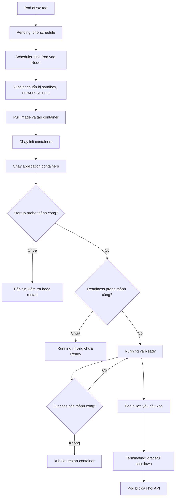
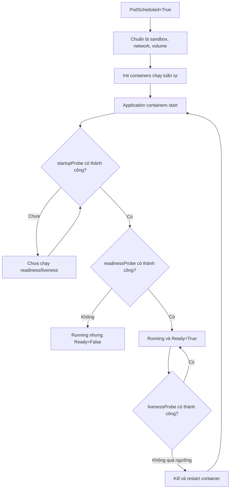

# Vòng đời Pod

## Mục lục

- [Vòng đời Pod là gì?](#vòng-đời-pod-là-gì)
- [Mental model từ lúc tạo đến lúc xóa](#mental-model-từ-lúc-tạo-đến-lúc-xóa)
- [Ba lớp trạng thái cần phân biệt](#ba-lớp-trạng-thái-cần-phân-biệt)
- [Pod phase](#pod-phase)
- [Pod conditions](#pod-conditions)
- [Container states](#container-states)
- [Restart policy](#restart-policy)
- [CrashLoopBackOff thực sự nghĩa là gì?](#crashloopbackoff-thực-sự-nghĩa-là-gì)
- [Startup, readiness và liveness probe](#startup-readiness-và-liveness-probe)
- [Luồng khởi động Pod](#luồng-khởi-động-pod)
- [Container restart và Pod replacement](#container-restart-và-pod-replacement)
- [Graceful termination](#graceful-termination)
- [Khi Node gặp sự cố](#khi-node-gặp-sự-cố)
- [Thực hành quan sát vòng đời](#thực-hành-quan-sát-vòng-đời)
- [Troubleshooting theo trạng thái](#troubleshooting-theo-trạng-thái)
- [Best practices](#best-practices)
- [Tóm tắt](#tóm-tắt)
- [Tài liệu tham khảo](#tài-liệu-tham-khảo)

---

## Vòng đời Pod là gì?

Pod không chuyển thẳng từ “đã tạo” sang “đang chạy”. Nó phải đi qua nhiều bước:

```text
Tạo object
→ chờ Scheduler chọn Node
→ kubelet chuẩn bị network và volume
→ pull image
→ chạy init container nếu có
→ chạy application container
→ kiểm tra startup/readiness/liveness
→ phục vụ workload
→ dừng và bị xóa
```

Kubernetes ghi lại quá trình này qua nhiều lớp trạng thái. Mỗi lớp trả lời một câu hỏi khác nhau:

```text
Pod phase       → Pod đang ở giai đoạn tổng quát nào?
Pod conditions  → Những điều kiện cụ thể nào đã đạt?
Container state → Từng container đang chờ, chạy hay đã kết thúc?
Events          → Gần đây Kubernetes đã làm gì và lỗi ở đâu?
```

Điểm quan trọng nhất cần nhớ:

> **Không thể chẩn đoán Pod chỉ bằng một giá trị trong cột `STATUS` của `kubectl get pods`.**

Ví dụ, Pod có thể có:

```text
phase: Running
Ready condition: False
container state: Running
```

Điều này nghĩa là process đang chạy nhưng Pod chưa nên nhận traffic từ Service.

Nếu chưa hiểu Pod là gì, cách Pod được schedule hoặc vì sao Pod có tính tạm thời, hãy đọc [Pod](/workloads/pod/) trước.

## Mental model từ lúc tạo đến lúc xóa

Một Pod chạy ứng dụng web thường có lifecycle như sau:



Không phải Pod nào cũng đi qua tất cả bước:

- Pod không có init container bỏ qua giai đoạn init.
- Pod không có probe được coi theo default tương ứng.
- Job Pod có thể kết thúc ở `Succeeded` hoặc `Failed`.
- Deployment Pod thường chạy liên tục cho đến khi rollout hoặc bị xóa.
- Pod có thể kẹt ở `Pending` nếu không có Node phù hợp.
- Container có thể lặp `start → crash → restart` trong cùng Pod.

Pod được schedule một lần trong lifecycle của UID. Sau khi bind vào Node, cùng Pod không được di chuyển sang Node khác. Nếu cần phục hồi trên Node khác, controller tạo Pod mới với UID mới.

## Ba lớp trạng thái cần phân biệt

Khi chạy:

```bash
kubectl get pods -n <namespace>
```

bạn thường thấy:

```text
NAME   READY   STATUS             RESTARTS   AGE
web    0/1     CrashLoopBackOff   5          3m
```

Các cột này là bản tóm tắt cho người đọc. Đặc biệt, `STATUS` không phải lúc nào cũng là `status.phase` trong Kubernetes API.

Ba lớp quan trọng:

| Lớp | Câu hỏi | Ví dụ |
|---|---|---|
| Pod phase | Pod đang ở giai đoạn tổng quát nào? | `Pending`, `Running`, `Succeeded` |
| Pod condition | Pod đã được schedule, initialized và Ready chưa? | `PodScheduled=True`, `Ready=False` |
| Container state | Container cụ thể đang chờ, chạy hay kết thúc? | `Waiting`, `Running`, `Terminated` |

Ví dụ `CrashLoopBackOff`:

```text
Pod phase: Running
Container state: Waiting
Waiting reason: CrashLoopBackOff
Last state: Terminated, exit code 1
```

Vì vậy `CrashLoopBackOff` không phải Pod phase. Nó là reason giúp diễn giải trạng thái container đang lặp crash và chờ restart.

### Bộ command đọc trạng thái

```bash
kubectl get pod <pod-name> -n <namespace> -o wide
kubectl describe pod <pod-name> -n <namespace>
kubectl get pod <pod-name> -n <namespace> -o yaml
kubectl logs <pod-name> -n <namespace>
kubectl get events -n <namespace> \
  --sort-by=.metadata.creationTimestamp
```

Có thể đọc theo thứ tự:

```text
phase
→ conditions
→ containerStatuses
→ Events
→ logs
```

## Pod phase

`status.phase` là bản tóm tắt cấp cao của Pod.

| Phase | Ý nghĩa dễ hiểu |
|---|---|
| `Pending` | Pod đã được cluster chấp nhận nhưng chưa có tất cả container sẵn sàng để chạy |
| `Running` | Pod đã bind vào Node và ít nhất một container đang chạy, start hoặc restart |
| `Succeeded` | Tất cả container đã kết thúc thành công và sẽ không restart |
| `Failed` | Tất cả container đã kết thúc, có ít nhất một container thất bại và không còn restart |
| `Unknown` | Control plane không lấy được trạng thái Pod, thường do mất liên lạc với Node |

Xem phase trực tiếp:

```bash
kubectl get pod <pod-name> -n <namespace> \
  -o jsonpath='{.status.phase}{"\n"}'
```

### `Pending` không chỉ nghĩa là chưa schedule

Pod có thể `Pending` trong nhiều giai đoạn:

```text
Pending
├── Scheduler chưa tìm được Node
├── Đã có Node nhưng đang pull image
├── Đang tạo Pod sandbox/network
├── Đang mount volume
└── Đang chờ Secret, ConfigMap hoặc resource khác
```

Cần xem `spec.nodeName`, conditions và Events để biết đang kẹt ở đâu.

```bash
kubectl get pod <pod-name> -n <namespace> \
  -o custom-columns='NAME:.metadata.name,NODE:.spec.nodeName,PHASE:.status.phase'
```

Nếu cột `NODE` trống, Pod thường chưa được schedule. Nếu đã có Node, vấn đề thường nằm ở kubelet, image, network, volume hoặc container setup.

### `Running` không đồng nghĩa `Ready`

`Running` chỉ là phase. Pod có thể:

- đang khởi động ứng dụng;
- readiness probe thất bại;
- một container chạy nhưng container khác đang restart;
- dependency chưa sẵn sàng;
- custom readiness gate chưa đạt.

Hãy kiểm tra cột `READY` và condition `Ready`.

### `CrashLoopBackOff`, `ImagePullBackOff` và `Terminating` không phải phase

Đây là các giá trị `kubectl` hiển thị để dễ đọc:

- `CrashLoopBackOff`: container crash lặp lại và đang trong thời gian backoff.
- `ImagePullBackOff`: kubelet pull image lỗi và đang chờ thử lại.
- `Terminating`: Pod có `deletionTimestamp` và đang được dừng/xóa.
- `Completed`: cách CLI thường hiển thị Pod đã hoàn thành; phase API thường là `Succeeded`.

Không viết automation dựa trên việc đoán mọi giá trị cột `STATUS`. Khi cần logic máy đọc, dùng field API cụ thể.

## Pod conditions

Conditions trả lời các câu hỏi chi tiết hơn phase. Mỗi condition có:

- `type`;
- `status`: `True`, `False` hoặc `Unknown`;
- `reason`;
- `message`;
- thời điểm chuyển trạng thái gần nhất.

Các condition thường gặp:

| Condition | Câu hỏi |
|---|---|
| `PodScheduled` | Scheduler đã gán Pod vào Node chưa? |
| `PodReadyToStartContainers` | Sandbox, network và các bước chuẩn bị cần thiết đã sẵn sàng chưa? |
| `Initialized` | Các init container đã hoàn thành chưa? |
| `ContainersReady` | Tất cả application container đã Ready chưa? |
| `Ready` | Pod có thể phục vụ request và tham gia load balancing chưa? |
| `DisruptionTarget` | Pod có đang là mục tiêu của một disruption không? |

Một số condition phụ thuộc phiên bản hoặc feature của cluster. Không giả định mọi cluster đều báo cùng một tập condition.

Xem conditions:

```bash
kubectl get pod <pod-name> -n <namespace> \
  -o jsonpath='{range .status.conditions[*]}{.type}{"="}{.status}{" reason="}{.reason}{"\n"}{end}'
```

Output minh họa:

```text
PodScheduled=True reason=
Initialized=True reason=
ContainersReady=False reason=ContainersNotReady
Ready=False reason=ContainersNotReady
```

### Cách đọc `PodScheduled`

```text
PodScheduled=False
└── tập trung vào Scheduler, requests, taints, affinity, PVC

PodScheduled=True
└── Pod đã có Node; tập trung vào kubelet, image, volume, container
```

Đây là cách chia đôi không gian troubleshooting rất nhanh.

### Cách đọc `ContainersReady` và `Ready`

Thông thường:

```text
ContainersReady=True
+ mọi readiness gate=True
→ Ready=True
```

Nếu container đã Ready nhưng custom readiness gate chưa đạt, `ContainersReady` có thể là `True` trong khi `Ready` vẫn là `False`.

### Readiness gates

`readinessGates` cho phép controller bên ngoài thêm condition vào quyết định Pod Ready:

```yaml
spec:
  readinessGates:
    - conditionType: example.com/external-ready
```

Pod chỉ `Ready=True` khi:

1. Tất cả container cần thiết Ready.
2. Condition `example.com/external-ready` tồn tại và là `True`.

Use case có thể là chờ hệ thống bên ngoài đăng ký endpoint hoặc hoàn thành một bước platform-specific. Nếu condition bị thiếu, Kubernetes coi gate đó chưa đạt.

Không dùng readiness gate khi readiness probe đơn giản đã đủ. Nó thêm dependency và cần controller có quyền cập nhật Pod status.

## Container states

Mỗi container có một trong ba state:

```text
Waiting → Running → Terminated
             ↑           │
             └── restart ┘
```

### `Waiting`

Container chưa chạy. Nó có `reason` giải thích lý do, ví dụ:

- `ContainerCreating`;
- `ErrImagePull`;
- `ImagePullBackOff`;
- `CrashLoopBackOff`;
- lỗi Secret hoặc ConfigMap.

Xem:

```bash
kubectl describe pod <pod-name> -n <namespace>
```

### `Running`

Process trong container đang chạy. State có `startedAt`.

`Running` không chứng minh:

- ứng dụng đã warm up;
- readiness probe thành công;
- ứng dụng trả response đúng;
- dependency hoạt động;
- container không sắp bị liveness probe restart.

### `Terminated`

Process đã kết thúc. State thường có:

- `exitCode`;
- `reason`;
- `signal` nếu bị signal dừng;
- `startedAt` và `finishedAt`;
- message liên quan.

Đọc state hiện tại và lần trước:

```bash
kubectl get pod <pod-name> -n <namespace> \
  -o jsonpath='{.status.containerStatuses[0].state}{"\n"}'

kubectl get pod <pod-name> -n <namespace> \
  -o jsonpath='{.status.containerStatuses[0].lastState}{"\n"}'
```

Ví dụ quan trọng:

```text
current state: Waiting, reason=CrashLoopBackOff
last state:    Terminated, exitCode=1
```

Backoff chỉ là trạng thái hiện tại. Exit code và logs của lần trước mới giúp tìm root cause.

### Nhiều container trong một Pod

Mỗi container có state và restart count riêng. Pod có thể `Running` trong khi một container khỏe và container khác crash.

```bash
kubectl get pod <pod-name> -n <namespace> \
  -o jsonpath='{range .status.containerStatuses[*]}{.name}{" state="}{.state}{" restarts="}{.restartCount}{"\n"}{end}'
```

Khi xem logs, chỉ rõ container:

```bash
kubectl logs <pod-name> -c <container-name> -n <namespace>
```

## Restart policy

`spec.restartPolicy` nói cho kubelet biết phải xử lý application container đã kết thúc như thế nào.

```yaml
spec:
  restartPolicy: Always
```

Ba giá trị cấp Pod:

| Exit của container | `Always` | `OnFailure` | `Never` |
|---|---|---|---|
| Exit code `0` | Restart | Không restart | Không restart |
| Exit code khác `0` | Restart | Restart | Không restart |

Giá trị mặc định là `Always`.

### Chọn restart policy theo workload

```text
Server cần chạy liên tục
→ Always

Task có thể retry trong cùng Pod khi lỗi
→ OnFailure

Muốn giữ Pod Failed để controller Job xử lý attempt mới hoặc debug rõ
→ Never
```

Deployment và DaemonSet dùng semantics chạy liên tục, nên Pod template của chúng dùng `Always`. Job chấp nhận `Never` hoặc `OnFailure`.

### Restart xảy ra ở đâu?

Restart policy chỉ điều khiển kubelet tạo lại container trong **cùng Pod trên cùng Node**:

```text
Pod UID aaa trên node-a
├── container ID 1 → exit
└── container ID 2 → kubelet restart
```

Nó không:

- tạo Pod mới;
- đổi Pod UID;
- chuyển Pod sang Node khác;
- tăng số replica;
- thay thế vai trò của Deployment hoặc Job controller.

### Init container và sidecar có nuance riêng

Regular init container phải hoàn thành trước application container. Kubernetes-native sidecar được khai báo trong `initContainers` với container-level `restartPolicy: Always`, nên có lifecycle khác application container.

Các feature container-level restart rules thay đổi theo phiên bản Kubernetes. Trang này tập trung vào `spec.restartPolicy` cấp Pod; kiểm tra API và tài liệu phiên bản cluster trước khi dùng restart rule nâng cao.

Đọc thêm tại [Init Containers](/workloads/init-containers/) và [Multi-container Pods](/workloads/multi-container-pods/).

## `CrashLoopBackOff` thực sự nghĩa là gì?

`CrashLoopBackOff` nghĩa là container:

1. Đã start.
2. Đã kết thúc hoặc bị kill.
3. Được restart policy yêu cầu chạy lại.
4. Tiếp tục thất bại.
5. kubelet tăng thời gian chờ trước lần restart tiếp theo.

```text
start → crash → chờ ngắn
start → crash → chờ lâu hơn
start → crash → chờ lâu hơn nữa
```

Backoff ngăn container lỗi tạo hot loop và tiêu tốn tài nguyên. Nó không phải root cause.

Root cause thường là:

- command hoặc arguments sai;
- thiếu config/environment variable;
- Secret hoặc file mount sai;
- application bug;
- dependency không truy cập được;
- container bị `OOMKilled`;
- liveness/startup probe kill container;
- permission hoặc security context không phù hợp.

### Command debug quan trọng nhất

```bash
kubectl logs <pod-name> -n <namespace> --previous
```

`--previous` đọc logs của container instance trước. Container hiện tại có thể đang Waiting nên chưa có log hữu ích.

Kiểm tra termination reason và exit code:

```bash
kubectl get pod <pod-name> -n <namespace> \
  -o jsonpath='reason={.status.containerStatuses[0].lastState.terminated.reason}{"\n"}exitCode={.status.containerStatuses[0].lastState.terminated.exitCode}{"\n"}'
```

Kiểm tra restart count:

```bash
kubectl get pod <pod-name> -n <namespace> \
  -o jsonpath='{.status.containerStatuses[0].restartCount}{"\n"}'
```

Đừng chỉ xóa Pod để “sửa” CrashLoopBackOff. Nếu image và config không đổi, Pod mới thường crash giống Pod cũ và evidence cũ có thể mất.

## Startup, readiness và liveness probe

Probe là kiểm tra định kỳ do kubelet thực hiện với container. Ba probe có ba câu hỏi khác nhau:

```text
startupProbe   → Ứng dụng đã khởi động xong chưa?
readinessProbe → Ứng dụng có nên nhận traffic lúc này không?
livenessProbe  → Ứng dụng có bị kẹt đến mức cần restart không?
```

### Bảng so sánh

| Probe | Khi thất bại | Mục tiêu |
|---|---|---|
| `startupProbe` | kubelet kill container sau khi vượt ngưỡng; restart theo policy | Cho ứng dụng thời gian khởi động |
| `readinessProbe` | Container vẫn chạy nhưng Pod không Ready | Ngừng gửi traffic tới Pod chưa phục vụ được |
| `livenessProbe` | kubelet kill container; restart theo policy | Phục hồi process bị kẹt không tự crash |

### `startupProbe`: “đã khởi động xong chưa?”

Ứng dụng Java hoặc data service có thể cần vài phút để load dữ liệu. Nếu liveness kiểm tra quá sớm, kubelet có thể restart trước khi ứng dụng khởi động xong.

```yaml
startupProbe:
  httpGet:
    path: /startup
    port: 8080
  periodSeconds: 5
  failureThreshold: 30
```

Ngân sách khởi động xấp xỉ:

```text
periodSeconds × failureThreshold
= 5 × 30
= 150 giây
```

Khi có startup probe, liveness và readiness chưa chạy cho đến khi startup probe thành công.

### `readinessProbe`: “có nhận traffic không?”

```yaml
readinessProbe:
  httpGet:
    path: /ready
    port: 8080
  periodSeconds: 5
  failureThreshold: 2
```

Khi readiness thất bại:

- container tiếp tục chạy;
- Pod condition `Ready=False`;
- EndpointSlice của Service phù hợp cập nhật để Pod không nhận traffic thông thường;
- kubelet tiếp tục probe để Pod có thể Ready lại.

Readiness phù hợp khi ứng dụng:

- đang warm cache;
- đang load model hoặc dữ liệu;
- tạm quá tải;
- chưa kết nối được dependency bắt buộc;
- cần tạm ngừng nhận request để maintenance.

### `livenessProbe`: “có cần restart không?”

```yaml
livenessProbe:
  httpGet:
    path: /live
    port: 8080
  periodSeconds: 10
  timeoutSeconds: 2
  failureThreshold: 3
```

Liveness nên chỉ thất bại khi restart container là hành động hợp lý, ví dụ process deadlock và không thể tự phục hồi.

> [!WARNING]
> Không nên để liveness phụ thuộc trực tiếp vào database hoặc external API. Nếu dependency outage, mọi Pod có thể restart đồng loạt, làm capacity giảm và sự cố nặng hơn.

Nếu process tự exit khi gặp lỗi không phục hồi, restart policy đã có thể đủ; không nhất thiết phải thêm liveness probe.

### Vì sao không dùng một endpoint cho mọi mục đích một cách máy móc?

Giả sử database tạm lỗi:

- Application vẫn sống và có thể phục hồi khi database trở lại.
- Nó chưa thể phục vụ request nghiệp vụ.

Behavior hợp lý thường là:

```text
/live  → success vì process còn khỏe
/ready → failure vì chưa phục vụ được
```

Nếu `/live` cũng fail theo database, kubelet restart application liên tục mà không sửa được database.

### Các cơ chế probe

| Cơ chế | Cách kiểm tra |
|---|---|
| `httpGet` | kubelet gửi HTTP request tới Pod IP và port |
| `tcpSocket` | kubelet thử mở TCP connection |
| `exec` | kubelet chạy command trong container; exit `0` là thành công |
| `grpc` | dùng gRPC Health Checking Protocol |

Chọn semantic mạnh nhất mà ứng dụng hỗ trợ. TCP port mở chỉ chứng minh process đang listen, không chứng minh request nghiệp vụ hoạt động.

### Các field quan trọng

| Field | Ý nghĩa |
|---|---|
| `initialDelaySeconds` | Chờ bao lâu sau khi container start trước khi bắt đầu probe |
| `periodSeconds` | Khoảng cách giữa các lần probe |
| `timeoutSeconds` | Một lần probe được chờ tối đa bao lâu |
| `failureThreshold` | Cần bao nhiêu lần fail liên tiếp để kết luận thất bại |
| `successThreshold` | Cần bao nhiêu lần success liên tiếp để được coi đã phục hồi |

Đặt interval quá ngắn hoặc dùng `exec` probe nặng trên nhiều Pod có thể tạo overhead. Health endpoint nên rẻ, ổn định và trả response nhỏ.

## Luồng khởi động Pod

Một Pod có init container và đủ ba probe thường đi qua:

```text
1. Scheduler bind Pod vào Node.
2. kubelet chuẩn bị sandbox, network và volume.
3. kubelet pull image.
4. Regular init containers chạy lần lượt.
5. Application containers start.
6. startupProbe chạy.
7. Khi startup thành công, readiness và liveness bắt đầu.
8. readiness thành công → Pod Ready.
9. liveness tiếp tục chạy trong suốt vòng đời.
```

Sơ đồ:



### Application containers không có thứ tự start mặc định

Nếu Pod có hai application container trong `spec.containers`, không nên giả định container viết trước trong YAML sẽ sẵn sàng trước.

Nếu container A phụ thuộc B:

- A nên retry với backoff;
- dùng readiness/startup probe;
- dùng init container cho điều kiện phải hoàn thành trước;
- dùng Kubernetes-native sidecar khi lifecycle phù hợp;
- tránh sleep cố định vì thời gian startup thay đổi.

## Container restart và Pod replacement

Kubelet restart container và controller thay Pod là hai cơ chế khác nhau.

### Container restart

```text
Pod web, UID aaa, node-a, IP 10.244.1.8
├── container ID 1 → crash
└── container ID 2 → kubelet restart
```

Pod UID, Node, IP và Pod volume thường giữ nguyên. Restart count tăng.

### Pod replacement

```text
Pod UID aaa trên node-a → bị xóa
Controller tạo Pod UID bbb
Scheduler có thể đặt Pod mới lên node-b
```

Pod mới có identity và lifecycle mới. IP, Node, container ID và `emptyDir` có thể thay đổi hoặc được tạo lại.

### Ai tạo Pod thay thế?

| Workload | Thành phần tạo Pod thay thế |
|---|---|
| Pod trần | Không có workload controller tự tạo lại sau khi object bị xóa |
| Deployment | ReplicaSet controller duy trì replica |
| StatefulSet | StatefulSet controller duy trì ordinal/identity |
| DaemonSet | DaemonSet controller duy trì Pod trên Node phù hợp |
| Job | Job controller retry/duy trì completion theo policy |

Restart policy không thay thế controller. Một Pod trần bị xóa sẽ không tự xuất hiện lại chỉ vì `restartPolicy: Always`.

## Graceful termination

Khi Pod bị xóa, Kubernetes cố cho ứng dụng thời gian dừng an toàn thay vì kill ngay.

Default grace period thường là 30 giây:

```yaml
spec:
  terminationGracePeriodSeconds: 30
```

Luồng đơn giản:

```text
1. Yêu cầu xóa Pod.
2. API Server đặt deletionTimestamp; Pod hiển thị Terminating.
3. Endpoint của Pod chuyển sang trạng thái không Ready cho traffic thông thường.
4. kubelet chạy preStop hook nếu có.
5. Runtime gửi stop signal, thường là SIGTERM, tới process chính.
6. Ứng dụng ngừng nhận request mới, hoàn thành việc đang xử lý và flush dữ liệu.
7. Nếu process thoát trong grace period, Pod được dọn bình thường.
8. Nếu vẫn chạy khi hết grace period, runtime gửi SIGKILL.
9. Pod chuyển terminal phase và bị xóa khỏi API.
```

Các bước ở control plane và Node có thể diễn ra song song; không nên phụ thuộc vào timing chính xác giữa chúng.

### Ứng dụng phải xử lý signal

Process chính trong container phải nhận stop signal và dừng an toàn.

Ví dụ Dockerfile:

```dockerfile
# Tốt: application là process chính và nhận signal trực tiếp.
CMD ["/app/server"]
```

Shell wrapper có thể làm signal không tới application nếu không dùng `exec` đúng cách:

```sh
#!/bin/sh
exec /app/server
```

Khi nhận `SIGTERM`, server nên:

1. Đánh dấu không sẵn sàng hoặc ngừng nhận request mới theo thiết kế.
2. Hoàn thành request đang xử lý trong giới hạn thời gian.
3. Flush logs, metric hoặc buffer cần thiết.
4. Release lock và đóng connection.
5. Exit trước khi grace period hết.

### `preStop` hook

```yaml
spec:
  terminationGracePeriodSeconds: 45
  containers:
    - name: app
      image: example.com/app:1.0.0
      lifecycle:
        preStop:
          exec:
            command:
              - /bin/sh
              - -c
              - /app/drain.sh
```

`preStop` chạy trong cùng grace period, không có một khoảng thời gian riêng vô hạn.

```text
terminationGracePeriodSeconds = 45s
├── preStop dùng 20s
└── application còn khoảng thời gian còn lại để shutdown
```

Nếu hook cần quá lâu, Pod có thể bị force kill. Ưu tiên để application tự xử lý signal; dùng `preStop` khi cần hành động bổ sung rõ ràng.

### Chọn grace period

Đặt dựa trên thời gian shutdown thực tế:

- HTTP request dài nhất cần hoàn thành;
- thời gian consumer commit offset;
- thời gian flush buffer;
- transaction timeout;
- thời gian đóng connection;
- behavior của load balancer và Service.

Grace period quá ngắn làm mất request/dữ liệu. Quá dài làm rollout, scale-down và drain chậm.

### Force delete là biện pháp cuối

```bash
kubectl delete pod <pod-name> -n <namespace> \
  --grace-period=0 --force
```

> [!CAUTION]
> Force delete xóa Pod object khỏi API mà không chờ xác nhận process trên Node đã dừng. Nếu Node mất kết nối, process cũ có thể vẫn chạy. Điều này đặc biệt nguy hiểm với singleton và StatefulSet.

Trước khi force delete:

- thu thập logs, Events và YAML;
- kiểm tra Node có reachable không;
- hiểu finalizer, volume và storage semantics;
- đánh giá nguy cơ hai instance cùng chạy;
- dùng runbook riêng cho StatefulSet hoặc dữ liệu nhạy cảm.

## Khi Node gặp sự cố

Nếu Node mất kết nối:

```text
Control plane không còn nhận status từ kubelet
→ Node chuyển NotReady/Unknown theo cơ chế liên quan
→ Pod trên Node không còn được coi khỏe
→ sau timeout/policy, Pod được đánh dấu/xử lý để xóa
→ controller tạo Pod replacement nếu cần
```

Đây không phải failover tức thời. Control plane cần phân biệt gián đoạn mạng ngắn với Node thật sự chết.

Điểm quan trọng:

- cùng Pod UID không chuyển sang Node khác;
- controller tạo Pod mới;
- Pod mới có thể được schedule lên Node khỏe;
- Pod trần không có controller duy trì replacement;
- storage attach/detach có thể làm phục hồi chậm hơn;
- process trên Node mất kết nối có thể còn chạy một thời gian.

Workload cần availability nên chạy nhiều replica trên failure domain phù hợp và không phụ thuộc một Pod duy nhất.

## Thực hành quan sát vòng đời

Lab gồm hai phần:

1. Quan sát Pod từ `Pending`/khởi động đến `Ready`, sau đó làm liveness fail để thấy container restart.
2. Tạo Pod crash để quan sát `CrashLoopBackOff` và `--previous` logs.

### Điều kiện trước khi bắt đầu

```bash
kubectl config current-context
kubectl get nodes
```

> [!WARNING]
> Lab tạo và xóa Namespace. Kiểm tra đúng context trước khi chạy.

### 1. Tạo Pod có probes

Lưu file `lifecycle-demo.yaml`:

```yaml
apiVersion: v1
kind: Pod
metadata:
  name: lifecycle-demo
  namespace: lifecycle-lab
  labels:
    app: lifecycle-demo
spec:
  terminationGracePeriodSeconds: 20
  containers:
    - name: web
      image: nginx:1.27-alpine
      command:
        - /bin/sh
        - -c
        - |
          set -eu
          touch /tmp/live
          echo "Process đã start, chờ 15 giây trước khi Ready"
          sleep 15
          touch /tmp/ready
          echo "Application Ready"
          exec nginx -g 'daemon off;'
      ports:
        - name: http
          containerPort: 80
      startupProbe:
        exec:
          command:
            - test
            - -f
            - /tmp/live
        periodSeconds: 2
        failureThreshold: 10
      readinessProbe:
        exec:
          command:
            - test
            - -f
            - /tmp/ready
        periodSeconds: 2
        failureThreshold: 1
      livenessProbe:
        exec:
          command:
            - test
            - -f
            - /tmp/live
        periodSeconds: 5
        failureThreshold: 3
      resources:
        requests:
          cpu: 20m
          memory: 32Mi
        limits:
          memory: 64Mi
  restartPolicy: Always
```

Tạo Namespace và apply:

```bash
kubectl create namespace lifecycle-lab
kubectl apply --dry-run=server -f lifecycle-demo.yaml
kubectl apply -f lifecycle-demo.yaml
```

### 2. Quan sát từ Running nhưng chưa Ready đến Ready

Ngay sau khi apply:

```bash
kubectl get pod lifecycle-demo -n lifecycle-lab --watch
```

Trong khoảng 15 giây đầu, Pod có thể `Running` nhưng `READY 0/1`. Sau khi file `/tmp/ready` được tạo, readiness probe thành công và Pod chuyển `1/1`.

Ở terminal khác, xem conditions:

```bash
kubectl get pod lifecycle-demo -n lifecycle-lab \
  -o jsonpath='{range .status.conditions[*]}{.type}{"="}{.status}{" reason="}{.reason}{"\n"}{end}'
```

Xem logs:

```bash
kubectl logs lifecycle-demo -n lifecycle-lab
```

Output minh họa:

```text
Process đã start, chờ 15 giây trước khi Ready
Application Ready
```

### 3. Làm liveness fail và quan sát restart

Xóa file mà liveness probe kiểm tra:

```bash
kubectl exec lifecycle-demo -n lifecycle-lab -- \
  rm /tmp/live
```

Theo dõi:

```bash
kubectl get pod lifecycle-demo -n lifecycle-lab --watch
```

Sau ba lần liveness fail liên tiếp, kubelet kill và restart container. Pod UID không đổi nhưng `RESTARTS` tăng.

Kiểm tra:

```bash
kubectl get pod lifecycle-demo -n lifecycle-lab \
  -o custom-columns='NAME:.metadata.name,UID:.metadata.uid,READY:.status.containerStatuses[0].ready,RESTARTS:.status.containerStatuses[0].restartCount'

kubectl describe pod lifecycle-demo -n lifecycle-lab
```

Container mới chạy command từ đầu, tạo lại `/tmp/live`, chờ 15 giây rồi Ready.

### 4. Tạo Pod crash có kiểm soát

Lưu file `crashloop.yaml`:

```yaml
apiVersion: v1
kind: Pod
metadata:
  name: crashloop
  namespace: lifecycle-lab
spec:
  containers:
    - name: worker
      image: busybox:1.36
      command:
        - sh
        - -c
        - |
          echo "Container bắt đầu"
          sleep 3
          echo "Giả lập lỗi với exit code 1"
          exit 1
  restartPolicy: Always
```

Apply và quan sát:

```bash
kubectl apply -f crashloop.yaml
kubectl get pod crashloop -n lifecycle-lab --watch
```

Sau vài lần restart, cột `STATUS` có thể hiển thị `CrashLoopBackOff`.

### 5. Tìm root cause thay vì chỉ nhìn BackOff

```bash
kubectl describe pod crashloop -n lifecycle-lab
kubectl logs crashloop -n lifecycle-lab
kubectl logs crashloop -n lifecycle-lab --previous
```

Xem state và last state:

```bash
kubectl get pod crashloop -n lifecycle-lab \
  -o jsonpath='phase={.status.phase}{"\n"}current={.status.containerStatuses[0].state}{"\n"}last={.status.containerStatuses[0].lastState}{"\n"}restarts={.status.containerStatuses[0].restartCount}{"\n"}'
```

Bạn sẽ thấy phase có thể là `Running`, state hiện tại có thể `Waiting` với reason `CrashLoopBackOff`, còn last state là `Terminated` với exit code `1`.

### 6. Quan sát graceful termination

Mở watch:

```bash
kubectl get pod lifecycle-demo -n lifecycle-lab --watch
```

Ở terminal khác, xóa Pod:

```bash
kubectl delete pod lifecycle-demo -n lifecycle-lab
```

Pod chuyển sang hiển thị `Terminating` trước khi biến mất. Với ứng dụng thật, đây là khoảng thời gian xử lý `SIGTERM`, drain traffic và flush dữ liệu.

Xem Events còn lại trong Namespace:

```bash
kubectl get events -n lifecycle-lab \
  --sort-by=.metadata.creationTimestamp
```

### 7. Cleanup

```bash
kubectl config current-context
kubectl delete namespace lifecycle-lab
```

## Troubleshooting theo trạng thái

Bắt đầu bằng cây quyết định:

```text
PodScheduled=False?
├── Có → scheduling: requests, taints, affinity, PVC
└── Không
    ├── Container Waiting → image, volume, config, runtime
    ├── Container crash → logs, exit code, OOM, probes
    ├── Running nhưng Ready=False → readiness, startup, dependency
    └── Terminating lâu → preStop, SIGTERM, finalizer, Node, volume
```

### Pod `Pending` và chưa có Node

```bash
kubectl describe pod <pod-name> -n <namespace>
kubectl get events -n <namespace> \
  --sort-by=.metadata.creationTimestamp
```

Tìm `FailedScheduling` và message như:

- thiếu CPU/memory;
- untolerated taint;
- node selector/affinity không match;
- PVC chưa bind;
- topology constraint không thỏa;
- quota hoặc admission chặn.

Kiểm tra Node đã được gán chưa:

```bash
kubectl get pod <pod-name> -n <namespace> \
  -o jsonpath='{.spec.nodeName}{"\n"}'
```

### Pod đã có Node nhưng kẹt `ContainerCreating`

```bash
kubectl describe pod <pod-name> -n <namespace>
kubectl get pod <pod-name> -n <namespace> -o yaml
```

Kiểm tra Events về:

- CNI không tạo được Pod sandbox;
- image pull;
- Secret/ConfigMap bị thiếu;
- volume mount lỗi;
- device/resource chưa cấp được;
- container runtime hoặc kubelet lỗi.

`ContainerCreating` là waiting reason, không nói chính xác root cause. Root cause nằm trong Events.

### `ImagePullBackOff`

```bash
kubectl describe pod <pod-name> -n <namespace>
```

Kiểm tra image name/tag, registry credential, architecture, registry connectivity, certificate và rate limit.

Đừng chờ backoff mà không sửa image/config; kubelet sẽ tiếp tục thử nhưng cùng lỗi vẫn lặp lại.

### `CrashLoopBackOff`

Thu thập trước khi xóa Pod:

```bash
kubectl logs <pod-name> -c <container-name> \
  -n <namespace> --previous

kubectl describe pod <pod-name> -n <namespace>

kubectl get pod <pod-name> -n <namespace> \
  -o jsonpath='{.status.containerStatuses[?(@.name=="<container-name>")].lastState.terminated}{"\n"}'
```

Phân biệt:

- `exitCode: 1` hoặc giá trị app-defined: đọc application logs;
- `reason: OOMKilled`: kiểm tra memory usage và limit;
- liveness/startup probe failure: đọc Events và probe config;
- signal termination: xác định ai gửi signal và vì sao;
- config error: kiểm tra env, Secret, ConfigMap và command.

### Pod `Running` nhưng chưa Ready

```bash
kubectl describe pod <pod-name> -n <namespace>
kubectl get pod <pod-name> -n <namespace> \
  -o jsonpath='{range .status.conditions[*]}{.type}{"="}{.status}{" "}{.reason}{" "}{.message}{"\n"}{end}'
```

Kiểm tra:

- readiness probe đúng path/port không;
- startup probe đã thành công chưa;
- ứng dụng có listen trên Pod IP hay chỉ `127.0.0.1` không;
- dependency bắt buộc có hoạt động không;
- custom readiness gate có condition chưa;
- sidecar hoặc container khác có chưa Ready không.

Không restart mù quáng nếu root cause là dependency. Readiness được thiết kế để Pod có thể tạm ngừng nhận traffic rồi tự phục hồi.

### Restart count tăng nhưng không thấy lỗi hiện tại

```bash
kubectl logs <pod-name> -c <container-name> \
  -n <namespace> --previous

kubectl get pod <pod-name> -n <namespace> \
  -o jsonpath='{.status.containerStatuses[?(@.name=="<container-name>")].lastState}{"\n"}'
```

Container hiện tại có thể đã khỏe lại, nhưng `lastState` cho biết lần restart gần nhất. Kiểm tra Events, OOM, probe failure và Node restart.

Restart count không tự reset chỉ vì container hiện khỏe; nó thuộc status của container trong Pod hiện tại.

### Pod `Terminating` quá lâu

```bash
kubectl get pod <pod-name> -n <namespace> -o yaml
kubectl describe pod <pod-name> -n <namespace>
kubectl get node <node-name>
```

Kiểm tra:

- `deletionTimestamp` và grace period;
- finalizers;
- `preStop` bị treo;
- application không thoát khi nhận signal;
- Node không reachable;
- volume unmount/detach chậm;
- kubelet hoặc runtime lỗi.

Thu thập evidence trước khi force delete. Nếu Pod chứa state hoặc thuộc StatefulSet, dùng runbook tương ứng.

### Pod biến mất và Pod mới xuất hiện

Kiểm tra owner và Events:

```bash
kubectl get pod <new-pod> -n <namespace> -o yaml
kubectl describe deployment <deployment> -n <namespace>
kubectl describe replicaset <replicaset> -n <namespace>
```

Các nguyên nhân có thể:

- Deployment rollout;
- scale up/down;
- eviction do Node pressure;
- Node failure;
- operator hoặc GitOps reconcile;
- người dùng xóa Pod;
- Job/CronJob tạo lần chạy mới.

So sánh UID và owner reference, không chỉ so tên gần giống.

### Không còn logs của container cũ

`kubectl logs --previous` chỉ đọc được instance trước trong Pod còn tồn tại. Nếu Pod đã bị xóa, logs cũ không còn qua kubelet/API.

Production cần:

- log collector tập trung;
- metric restart và probe failure;
- event retention phù hợp;
- correlation ID và Pod metadata trong logs.

## Best practices

- Đọc trạng thái theo lớp: phase → conditions → container state → Events → logs.
- Không coi `Running` là đồng nghĩa với `Ready`.
- Nhớ rằng `CrashLoopBackOff` và `ImagePullBackOff` là backoff reason, không phải root cause.
- Dùng `kubectl logs --previous` trước khi xóa Pod crash.
- Dùng startup probe cho ứng dụng khởi động chậm.
- Dùng readiness để điều khiển traffic, liveness để phát hiện trạng thái chỉ restart mới sửa được.
- Không cho liveness phụ thuộc mù quáng vào external dependency.
- Giữ health endpoint nhẹ, nhanh và có semantic rõ.
- Đặt timeout/threshold probe dựa trên latency và startup thực tế.
- Xử lý stop signal và graceful shutdown trong ứng dụng.
- Đặt termination grace period theo thời gian drain/flush thực tế.
- Tránh force delete nếu chưa hiểu rủi ro và chưa thu thập evidence.
- Dùng workload controller để tạo Pod replacement.
- Chạy nhiều replica cho workload cần availability; Node failover không tức thời.
- Gửi logs và metrics ra hệ thống tập trung vì Pod/container cũ có thể biến mất.
- Test startup chậm, readiness failure, liveness failure, OOM, rollout và shutdown trong staging.

## Tóm tắt

Mental model ngắn nhất:

```text
Pod phase
→ bức tranh tổng quát

Pod conditions
→ các cột mốc đã đạt hay chưa

Container state
→ container cụ thể đang làm gì

Events + logs
→ vì sao trạng thái đó xảy ra
```

Ba probe:

```text
startup   = đã khởi động xong chưa?
readiness = có nhận traffic không?
liveness  = có cần restart không?
```

Hai cơ chế phục hồi:

```text
Container crash
→ kubelet restart container trong cùng Pod theo restartPolicy

Pod bị xóa/Node lỗi/rollout
→ workload controller tạo Pod replacement có UID mới
```

Năm điều quan trọng nhất:

1. Cột `STATUS` của `kubectl` không phải lúc nào cũng là Pod phase.
2. `Running` không đảm bảo `Ready`.
3. `CrashLoopBackOff` chỉ nói kubelet đang chờ restart; root cause nằm trong logs, exit code và Events.
4. Restart container giữ Pod UID; replacement tạo Pod UID mới.
5. Graceful termination chỉ hiệu quả khi application xử lý signal và thoát trong grace period.

Tiếp tục với [Init Containers](/workloads/init-containers/) để hiểu giai đoạn chuẩn bị phải hoàn thành trước application container.

## Tài liệu tham khảo

- [Pod Lifecycle](https://kubernetes.io/docs/concepts/workloads/pods/pod-lifecycle/)
- [Liveness, Readiness, and Startup Probes](https://kubernetes.io/docs/concepts/configuration/liveness-readiness-startup-probes/)
- [Container Lifecycle Hooks](https://kubernetes.io/docs/concepts/containers/container-lifecycle-hooks/)
- [Pods and Endpoints Termination Flow](https://kubernetes.io/docs/tutorials/services/pods-and-endpoint-termination-flow/)
- [Pod](/workloads/pod/)
